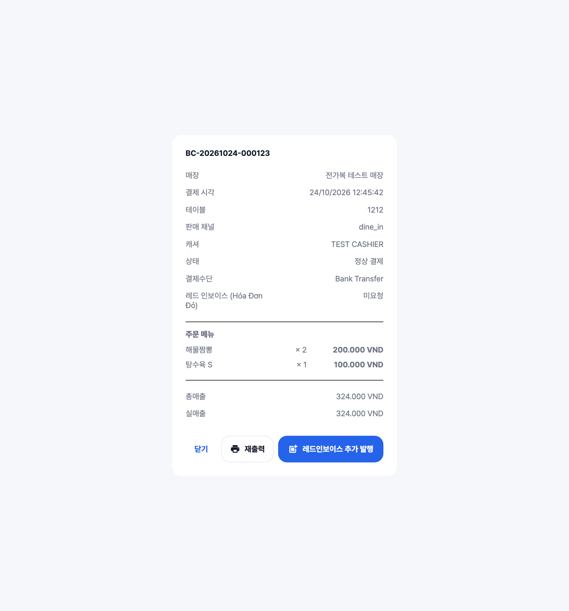
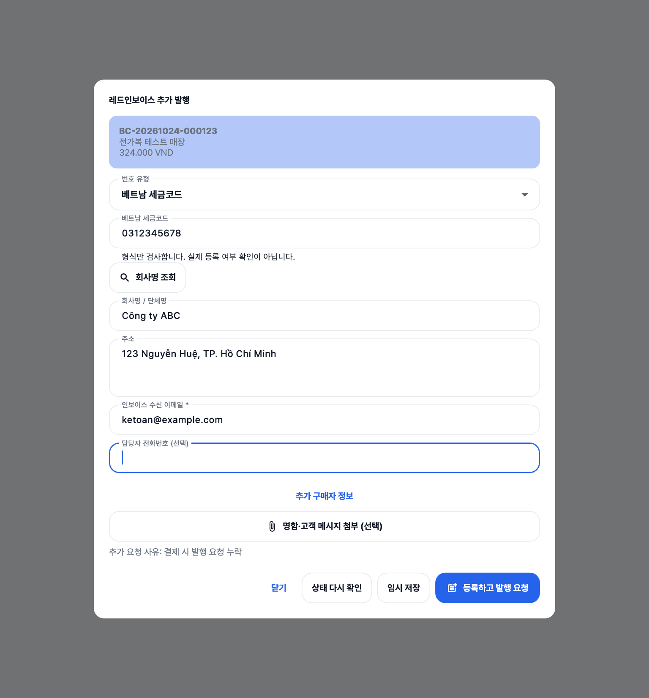
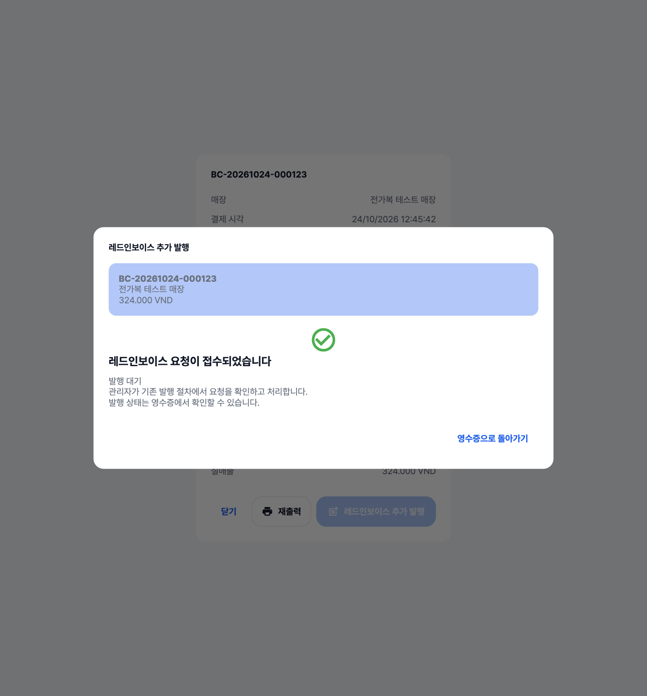

# 레드인보이스 추가 발행 요청 구현

2026-10-24, Asia/Ho_Chi_Minh. 기능 구현과 운영 데이터가 없는 로컬 검증을 대상으로 한다. 운영 배포, 운영 마이그레이션, 실제 MISA 전송·발행·메일 발송은 실행하지 않았다.

## 구현한 흐름

- 캐셔의 **오늘 영수증 → 영수증 상세** 하단에 `레드인보이스 추가 발행` 버튼을 추가했다. 기존 닫기·영수증 재인쇄를 유지했다. 목록과 상세에서 요청 상태를 확인할 수 있다.
- 슈퍼관리자의 **일반 영수증 원장**에서 구매자 정보가 없는 건에도 같은 입력 화면으로 들어간다. 저장하면 해당 영수증을 일반 목록에서 제거하고 상위 매출 화면의 분류를 갱신한다.
- 기존 영수증 번호·매장·금액을 표시하고 공통 구매자 폼, 회사명 조회, 선택 증빙 첨부를 사용한다. `임시 저장`과 `등록하고 발행 요청`을 구분한다.
- 전화번호는 선택 입력이다. 기존 POS 입력·직접 주문 동기화·legacy 최소 입력 RPC의 전화번호 필수 판정을 제거하고, 내보내기의 `MISSING_BUYER_PHONE` 차단도 제거했다. 입력한 전화번호는 문자열로 보존한다.
- 저장 직후에는 **요청 접수·발행 대기**를 표시한다. 발행·신고된 건, 전송 결과가 불명확한 건에는 새 요청 버튼을 제공하지 않고 상태 확인과 MISA 공식 포털로 연결한다. 메뉴 매핑/연동 설정/관리자 확인 대기 사유를 표시한다.
- 발행 준비 상태는 기존 관리자 발행 절차로 이어진다. 이 기능이 `dispatch_paused`를 임의로 풀거나 소유자의 매출 확인·신고 절차를 건너뛰지는 않는다.

## 실제 구현 화면

아래 이미지는 생성 시안이 아니라 **실제 Flutter 위젯을 앱의 AppTheme·Pretendard 폰트로 실행한 로컬 테스트 캡처**다. 영수증·구매자·금액은 합성 fixture이며 운영 고객 자료를 사용하지 않았다. 입력 성공과 화면 동작은 주입된 RPC 응답으로 검증하고, 서버 저장·권한·경합은 별도의 실제 PostgreSQL 함수로 검증한다.







## 중복 방지와 원본 보호

새 `pos_late_invoice_context`가 로그인 사용자·매장·원본 결제와 최신 처리 상태를 확인한다. `pos_submit_late_invoice`는 다음을 한 트랜잭션으로 처리한다.

1. 요청 ID와 실제 사용자·입력 내용의 일치 확인. 같은 요청을 다시 보내면 이미 처리된 요청임을 확인하고 최신 상태를 반환한다. 다른 내용이나 사용자가 같은 ID를 재사용하면 거부한다.
2. 직접 주문 요청, 주문, 결제, 계산서 작업, 구매자 정보에 일관된 잠금을 잡고 최신 buyer_version을 재확인한다. 기존 매출 배치와 같은 advisory lock을 사용한다.
3. 발행·전송 이력, dispatch claim, 외부 신고 보호, 생성·확정·신고 배치, 환불·취소, 매장·법인 불일치를 검사한다. 재시도로 dispatch_attempts가 초기화되어도 기존 dispatch 이벤트를 확인한다. 구형 계산서의 발행 이력도 보호한다.
4. 기존 order_id의 작업을 재사용해 구매자 종류와 스냅샷을 함께 갱신한다. 작업이 없는 예외는 원본 결제에서 생성한다. 혼합 VAT는 기존 순수 세금 명세 분리 함수를 사용한다.
5. 합산 결제와 직접 주문의 연결 주문을 집합으로 처리한다. 최대 100개를 넘거나 복수 합산 그룹의 일부만 도달하는 비정상 연결은 검토 대상으로 남기고 부분 저장하지 않는다.
6. 금액·품목·수량·할인·VAT·결제수단·결제/디지털 영수증 이력을 유지하고 실제 요청자와 변경 버전을 감사 이력에 남긴다.

불변 스냅샷 검사는 유지하면서, 변경된 작업의 외부 신고 검사·이전 버전 보관을 transition table을 사용한 statement 단위 처리로 바꾸었다. 행 단위 검사는 SQL 조회 없이 발행 상태를 검사하고 버전을 증가시킨다. 합산 주문마다 외부 보호 조회와 archive INSERT를 반복하지 않는다. 외부 신고된 스냅샷을 직접 UPDATE하는 경로도 전체 문장을 거부한다.

## 검증과 재현

다음 명령은 운영 자격 증명·데이터 없이 실행한다.

```bash
dart analyze --fatal-infos
flutter test --no-pub test/late_invoice_widget_test.dart \
  test/pos_buyer_information_test.dart test/receipt_ledger_contract_test.dart \
  test/red_invoice_intake_workbook_test.dart \
  test/red_invoice_intake_overlay_operational_test.dart \
  test/corporate_sales_reference_test.dart
bash test/late_invoice_sql_test.sh
deno test --no-config supabase/functions/_shared/meinvoice_ledger_test.ts
bash scripts/check_repo.sh
```

새 SQL 검증은 실제 선행 구매자 함수·실제 세금 명세 분리 함수·실제 원장 페이지 함수와 새 migration을 분리된 PostgreSQL 컨테이너에 적용한다. 원본 금액 보존, 전화번호 공란/앞자리 0, 필수 정보 오류, 이전 버전 보관, 권한·매장 격리, 합산/직접 주문, 보호된 배치·외부 발행·구형 발행·dispatch 이력을 확인한다.

실제 동시 세션으로 같은 요청의 재전송, 다른 요청 ID의 동시 저장, dispatcher claim, 환불, 매출 배치 확정, 구형 입력 RPC와의 경합을 검사한다. 구형 입력도 주문부터 잠그도록 보완했다. 두 단말이 같은 요청을 보내도 작업은 하나이며, 다른 요청의 경쟁에서는 하나만 저장되고 오래된 버전은 거부되어야 한다. 저장 중 키보드 입력을 잠그고, 입력창을 연 뒤 로그인이 바뀌면 새 사용자로 해당 내용을 제출하지 않는다.

성능 검증은 500개 영수증을 50개씩 10회 커서 조회하여 누락·중복과 응답 크기를 확인한다. 기존 권한 확인 원장 RPC 안에서 현재 페이지의 상태만 한 번의 집합 쿼리로 추가한다. 목록에 영수증별 job provider를 추가하지 않았다. 50개 연결 주문 쓰기는 클라이언트 RPC 1회, 상태 확인 3회, 이전 스냅샷 보관 statement 1회로 계수한다. 실제 행·응답 바이트·함수 호출·로컬 SQL 시간은 전체 로그에 남기며 운영 응답 시간으로 해석하지 않는다.

전체 검증은 커밋 후 깨끗한 후보 SHA에서 기존 로컬 Linux 계약으로 수행한다.

```bash
python3 -B scripts/pos_local_release_gate.py run --kind candidate \
  --output /absolute/new/private/late-invoice-candidate-evidence
python3 -B scripts/pos_local_release_gate.py verify --kind candidate \
  --evidence /absolute/new/private/late-invoice-candidate-evidence
```

최종 SHA·환경·명령·시각·종료 코드·검사 건수·로그 해시는 위 실행의 외부 `receipt.json` 및 전체 로그를 기준으로 한다. 검사 결과는 실행 뒤 보고하며 이 문서가 PASS를 대신하지 않는다. 새 SQL 검증을 `scripts/check_repo.sh`에 포함했다.

## 운영 반영 범위

신규 migration은 `supabase/migrations/20261024220000_pos_late_red_invoice.sql`이다. 운영 반영 때는 공식 배포 스크립트의 `--migration` 경로와 최신 exact-main 로컬 검증·Auth·로그인·영수증 기능 검증을 유지해야 한다. 운영 DB에 수동 적용하지 않았다. Windows 네이티브 패키지/실제 프린터·MISA 실발행은 별도 운영 검증 범위이며 이번 로컬 위젯·SQL 성공과 구분한다.

MISA 포털은 [공식 도움말에서 안내하는 발행 화면](https://helpv4.meinvoice.vn/kb/huong-dan-chuyen-giao-dien-phat-hanh-hoa-don-sang-xu-ly-hoa-don-va-nguoc-lai/)으로 연결하며, 고객 자료나 인증 토큰을 URL에 넣지 않는다.
