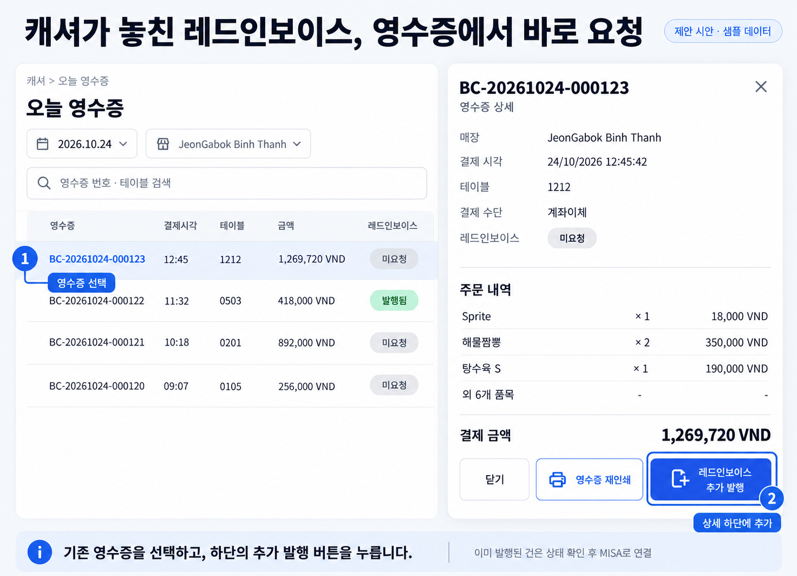
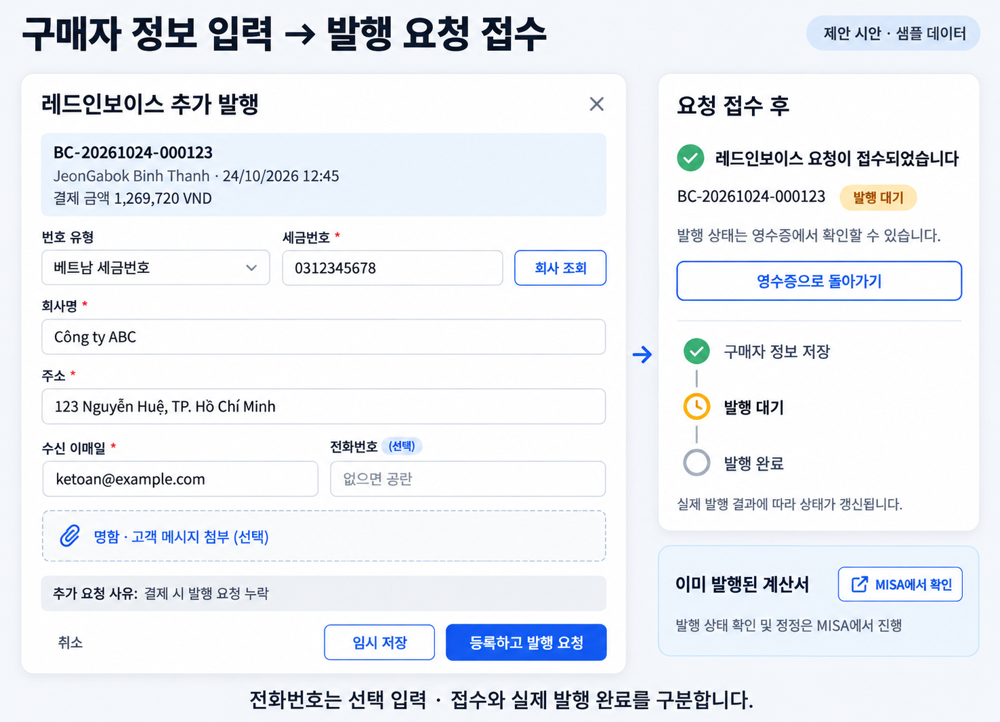

# 결제 후 레드인보이스 추가 발행 요청 — 계획

작성일: 2026-10-24, Asia/Ho_Chi_Minh. 상태: 검토용 계획과 화면 시안. 기능 구현·스키마 변경·배포·실제 MISA 발행은 수행하지 않았다. 화면은 샘플 데이터다.

## 제안

캐셔가 결제 때 레드인보이스 요청을 놓쳤으면 **캐셔 → 오늘 영수증 → 해당 영수증 상세 → `레드인보이스 추가 발행`**에서 구매자 정보를 입력한다. 저장 후 원본 매출과 연결된 발행 요청을 기존 처리 흐름에 전달한다.

미발행 건의 추가 요청, 요청만 저장된 건의 정보 보완, 이미 외부에 발행된 계산서의 처리는 상태에 따라 구분한다. 이미 발행된 계산서의 정정·대체·취소·PDF는 기존 MISA 포털에서 처리한다. 요청 저장, POS 발행 준비, MISA 전송, 실제 발행 완료를 각각 표시한다.

## 1. 화면과 버튼

### 주 진입점: 캐셔의 오늘 영수증

- 기존 `/receipts/today`를 사용한다. 날짜 선택과 영수증 번호·테이블 검색을 유지한다.
- 목록에 `레드인보이스` 상태를 추가한다. 목록 각 행에는 새 발행 버튼을 늘어놓지 않고 영수증을 선택하게 한다.
- 영수증 상세에는 결제수단 다음에 레드인보이스 상태를 표시한다.
- 상세 하단 오른쪽에 문서+ 아이콘과 파란색 **`레드인보이스 추가 발행`** 버튼을 둔다.
- 기존 `닫기`는 텍스트 버튼, `영수증 재인쇄`는 테두리 버튼으로 배치한다. 좁은 화면에서는 추가 발행 버튼을 전체 너비 한 줄로, 닫기·재인쇄를 다음 줄에 배치한다. 본문은 스크롤하고 하단 액션은 유지한다.
- 현재 영수증으로 돌아왔을 때 요청 결과가 반영되어야 한다. 검색어·선택 날짜·페이지·매장 선택을 보존한다.

### 보조 진입점: 슈퍼관리자 매출의 일반 영수증 상세

`매출 내보내기 → 일반 영수증 원장 → 상세`의 구매자 정보가 없는 영역에도 같은 버튼을 둔다. 기존에는 이 경우 “등록된 구매자 정보가 없습니다”만 표시되고 편집 버튼이 없다. 두 진입점에서 같은 폼과 서버 처리 함수를 사용한다. 이 기능 때문에 기존 슈퍼관리자 전용 원장·레드인보이스 관리 화면을 캐셔에게 공개하지 않는다.

### 구매자 정보 폼

제목은 **`레드인보이스 추가 발행`**이다. 위쪽에 매장·원본 영수증 번호·결제일시·금액을 읽기 전용으로 고정한다.

| 항목 | 계획 |
| --- | --- |
| 번호 유형 | 기존 구매자 번호 유형을 재사용. 사업자 요청의 기본값은 베트남 세금번호 |
| 세금번호 | 유형에 맞는 형식 검증, 기존 회사 조회 기능 사용 |
| 회사명 / 구매자명 | 유형에 맞는 명칭 입력. 회사 조회 결과는 기존 수동 수정 동작 보존 |
| 주소 | 입력 및 확인 |
| 수신 이메일 | 기존 이메일 수신 운영 방식 유지. 이메일 필수 표시는 법적 필수와 구별 |
| 전화번호 | **선택 입력**. 입력했으면 문자열로 보존하고 앞자리 0 유지 |
| 명함·고객 메시지 | 기존 증빙 첨부를 선택 사항으로 제공. 자동 OCR은 이번 범위에 추가하지 않음 |
| 추가 요청 사유 | 기본값 `결제 시 발행 요청 누락`, 필요하면 메모 추가. 기존 source 값과 별개로 감사 이력에 기록 |

하단 버튼은 `취소`, **`임시 저장`**, 파란색 **`등록하고 발행 요청`**이다. 임시 저장은 정보 보완 대기, 필수 정보가 갖춰진 요청은 발행 준비 상태로 저장한다. 제출 중 버튼 중복 실행을 막는다. 오류가 나면 입력 내용을 보존한다.

제출 성공 문구는 **`레드인보이스 요청이 접수되었습니다`**, 보조 문구는 **`발행 상태는 영수증에서 확인할 수 있습니다`**로 한다. 저장 성공만으로 발행 완료라고 표시하지 않는다. 설정·매핑·기존 매출 확인 절차가 필요한 경우 해당 대기 사유를 보여준다.

### 버튼 문구의 언어별 기준

| 위치 | 한국어 | 베트남어 | 영어 |
| --- | --- | --- | --- |
| 영수증 상세 | 레드인보이스 추가 발행 | Yêu cầu xuất hóa đơn VAT | Request VAT invoice |
| 폼 제출 | 등록하고 발행 요청 | Lưu và yêu cầu xuất | Save and request invoice |
| 초안 | 임시 저장 | Lưu nháp | Save draft |
| 진행 조회 | 발행 상태 보기 | Xem trạng thái hóa đơn | View invoice status |
| 외부 발행본 | MISA에서 확인 | Xem trên MISA | Open in MISA |

## 2. 상태별 동작

서버가 권한과 최신 상태로 허용 동작을 결정한다. `intake 없음`이나 `buyer_kind=anonymous`만으로 미발행이라고 판단하지 않는다. 일반 소비자 계산서가 이미 외부 발행되었을 수도 있다.

| 실제 상태 | 표시·동작 |
| --- | --- |
| 결제 완료, 요청 없음, 외부 전송·발행·신고·보호된 배치 없음 | `레드인보이스 추가 발행` |
| 요청은 있고 정보 부족 | `구매자 정보 보완`, 기존 정보와 buyer_version으로 편집 |
| 정보 준비 완료, 아직 전송 안 됨 | `발행 상태 보기`, 서버가 허용한 경우에만 구매자 정보 수정 |
| 설정·메뉴 매핑·매출 확인 필요 | 대기 사유와 관리자 처리 경로 표시. 준비 상태와 실제 전송 가능 상태 구분 |
| 전송 중·claim 보유·시도 이력 존재·응답 불명확 | 새 발행 요청을 막고 `발행 상태 확인`. 외부 도달 여부를 확인하기 전 새 작업·참조번호 생성 금지 |
| 외부 발행·세무 신고 완료, 일반 소비자 발행본 포함 | `MISA에서 확인`. POS에서 발행본 덮어쓰기나 새 계산서 중복 발행 금지 |
| 생성·확정된 매출 신고 배치와 충돌 | 관리자 검토. 생성 파일은 버전 변경에 따라 재생성, 확정 건은 기존 소유자 처리 절차 사용 |
| 취소·전액 환불·부분 환불·판매 아닌 건 | 상태·사유 표시 후 관리자 검토. 금액을 임의로 바꾸어 재요청하지 않음 |
| 조회 실패·외부 상태 불명·권한 없음 | 추가 발행을 활성화하지 않고 재조회·권한 안내 |

MISA 조회 링크가 없으면 실제 연동으로 검증된 포털 진입 경로를 사용한다. 확인하지 않은 URL을 추정하여 만들지 않는다. 현재 `einvoice_provider.dart`는 `lookupUrl: null`이므로 이 연결도 구현·검증 대상이다.

## 3. 서버 처리와 원본 보존

### 인증·권한

- 실제 로그인 사용자의 `auth.uid()`와 활성 사용자 매핑으로 처리한다. 캐셔는 접근 가능한 본인 매장, 관리자는 접근 가능한 매장, 슈퍼관리자는 기존 전체 접근 범위를 따른다.
- 매장·법인·주문·결제 연결을 서버에서 다시 확인한다. 클라이언트가 전달한 권한·금액·발행 가능 여부를 신뢰하지 않는다.
- 기존 Photo Objet 제한, 비매출·취소 상태 및 외부 발행 보호 규칙을 보존한다.
- 이력에는 실제 요청자, 시각, 원본 영수증/주문/결제 식별자, 사유, 변경 필드·버전, 처리 결과를 기록한다. 지원 담당자가 매번 운영 SQL로 보정할 필요 없는 경로를 만든다.

### 원자적 저장

기존 `pos_save_buyer_information`과 구매자 폼을 재사용하되, 결제 후 요청 전용 서버 진입점에서 다음을 한 트랜잭션으로 처리하는 안이다. 함수명은 구현 때 확정한다.

1. 원본 결제·영수증·연결 주문과 최신 intake/job 버전, 발행 시도·claim·외부 신고·배치 보호 상태 확인.
2. 기존 direct-order 요청이 연결된 경우 기존 잠금 순서를 보존하며 대상 전체를 일관된 순서로 잠금. dispatcher·기존 구매자 수정 경로와 경합 테스트 후 잠금 순서 확정.
3. 구매자 필수 정보 검증. 전화번호 공란 허용. 신규 intake는 expected_version을 NULL로, 기존 건은 조회한 buyer_version을 전달한다. 낡은 버전이면 덮어쓰기 대신 재확인 안내. 관리자 원장 서비스의 현재 필수 정수 version 인자도 신규 생성 경로를 수용하도록 조정한다.
4. 기존 `red_invoice_intakes` 생성/수정과 `meinvoice_jobs`의 구매자 종류·스냅샷을 함께 반영. 기존 작업은 재사용하고, 없으면 원본 결제에서 정식 생성. 금액·메뉴·수량·할인·VAT·결제수단은 판매 당시 스냅샷 유지.
5. 기존 스냅샷 버전 보존 트리거를 유지하여 이전 값을 보관. 이미 전송·발행된 스냅샷 보호를 완화하지 않음.
6. 저장된 요청을 현재 MISA/내보내기 처리 흐름에 연결. 자동 발행 가능 조건을 만족할 때만 기존 큐에서 처리하며, 비활성 설정·매핑 누락·소유자 확인 필요 상태를 자동 해제하지 않음.
7. 감사 이력과 최신 영수증 상태를 반환. 저장 완료와 실제 발행 완료를 구분.

현재 일반 구매자 저장 함수는 intake 중심으로 저장하며 job의 전체 구매자 스냅샷 동기화를 보장하는 전용 추가 발행 동작이 아니다. UI 버튼 연결만으로 끝내지 않고 intake·job·내보내기 결과가 같은 구매자를 나타내는지 확인한다.

중복 클릭·동시 단말·네트워크 타임아웃에 대비해 요청 ID와 기존 영수증/작업 고유키로 멱등성을 보장한다. 재시도 시 같은 결과를 반환하고 새 작업을 만들지 않는다. 외부 발행 결과가 불명확한 작업은 자동 재전송하지 않는다.

합산 결제는 대표 결제그룹과 연결 주문 전체를 서버에서 확인한다. 기존 발행 단위와 금액 배분을 유지하고 일부 주문에만 구매자 정보를 넣지 않는다. 대상 일부가 이미 전송·발행·보호된 경우 전체를 검토 상태로 돌린다. 매장·법인이 다른 항목을 임의로 묶지 않는다. 분할 결제의 여러 payment ID를 여러 개의 추가 발행 요청으로 만들지 않는다.

## 4. 전화번호 선택 입력을 함께 정리

현재 전화번호 필수 검증은 UI 폼, POS 구매자 저장 RPC, 일부 기존 intake/direct-order 동기화 경로, 내보내기 검증에 남아 있다. 폼의 별표만 제거하면 후속 단계에서 다시 차단되므로 다음을 함께 변경한다.

- `buyer_information_form.dart`의 전화번호 공란 검사와 문구.
- 실제 적용 순서상 유효한 구매자 저장·legacy 최소 저장·direct-order 구매자 동기화·검증 함수의 완전성 판정.
- `restaurant_sales_export.dart`의 `MISSING_BUYER_PHONE` 차단 및 관련 내보내기 계약.
- 저장 값, MISA payload와 Excel 내보내기의 공란/입력값 보존. 전화번호를 다른 자료에서 추정하거나 대체 번호를 넣지 않음.

MISA 공식 API의 `BuyerPhoneNumber`는 필수 여부 `Không`(아니오)로 명시되어 있다. 이 근거는 전화번호 선택 입력에 한정하며 다른 구매자 필드의 법적 요건을 같은 표에서 단순 추론하지 않는다.

근거: [MISA EInvoice 속성 문서, 1.3 구매자 정보](https://doc.meinvoice.vn/api/Document/InvoiceInfo.html).

## 5. 조회 범위와 성능 계획

- 목록은 현재 영업일·매장·검색 조건과 **50건 커서 페이지**를 유지한다. 현재 페이지에 필요한 invoice summary만 집합 조회/사전 집계하여 한 번에 반환한다.
- 영수증마다 `EinvoiceStatusBadge`의 개별 job provider를 붙이지 않는다. 목록 호출은 페이지당 기존 RPC 1회이며, 상태 정보 추가 때문에 50건을 51회로 늘리지 않는다.
- 상세 진입 시 최신 수정 가능 상태·기존 구매자·연결 주문을 **상세 RPC 1회**, 저장은 **쓰기 RPC 1회**로 처리한다. 단일 영수증은 한 번에 한 요청만 실행한다.
- 합산 결제는 연결 주문을 일괄 처리한다. 쓰기 대상 상한은 기존 지원 한도를 확인해 최대 100개 이하로 명시하고, 초과 시 부분 저장 없이 관리자 안내. SQL 내부에서도 주문별 반복 조회를 만들지 않는다.
- 회사 조회는 기존 디바운스·캐시·진행 중 공유 정책을 재사용한다. 첨부 업로드는 선택한 파일에만 기존 크기 제한을 적용하며 저장 RPC와 호출 수를 별도 계상한다.
- 저장 응답으로 해당 영수증 상태를 갱신하고, 동일 이벤트로 화면 전체가 중복 재조회되지 않게 한다. 캐시 키에 사용자·매장·영업일·원본 영수증을 포함한다.
- 구현 후 1/50/500개 영수증 fixture에서 호출 수, 반환 행 수/바이트, 상세·저장 SQL 시간, 실제 UI 체감 시간을 측정한다. 500건은 50건씩 10페이지이며 페이지당 추가 호출이 없어야 한다. 조회 조건·JOIN 중복·인덱스와 실행 계획을 확인하되 무조건 인덱스를 추가하지 않는다.
- 위 수치는 설계상 상한/예산이다. 이번 계획 단계에서는 성능 테스트를 실행하거나 개선 수치를 주장하지 않았다.

## 6. 구현 순서와 완료 기준

| 순서 | 범위 | 완료 기준 |
| --- | --- | --- |
| 1 | 현재 적용 RPC·제약·권한·발행/신고 경로 확정 | 소스와 운영 정의 차이, 보존할 상태·원본 계약 목록 확보 |
| 2 | 원자적 추가 요청 RPC와 멱등성·버전·보호 상태 | 정상·누락 job·동시 요청·전송 경합·권한/매장 격리 SQL 검증 통과 |
| 3 | 공통 입력 폼·전화번호 선택 계약 | 전화번호 없는 정상 요청, 앞자리 0, 초안, 기존 direct-order/내보내기 회귀 통과 |
| 4 | 캐셔 오늘 영수증 및 슈퍼관리자 원장 버튼 | 정보 없는 일반 영수증에서 시작, 입력·저장·재진입·중복 클릭·오류 복구 확인 |
| 5 | MISA/내보내기 처리와 상태·링크 | 저장 성공을 발행 완료로 표시하지 않고 보호된 건은 MISA로 연결 |
| 6 | 최종 검증 및 공식 운영 반영 준비 | 최종 SHA에 연결한 로컬 검증·실제 원격 SHA·공식 배포/운영 검증 증거 |

검증은 다음을 포함한다.

- 기존 결제 후 즉시 레드인보이스 요청, 명함/메시지 후등록, 캐셔 누락 후 추가 요청.
- 등록 없음·초안·준비·전송 중·실패 원인 확정/불명·이미 발행·외부 신고·보호된 매출 배치.
- 권한 없는 사용자, 다른 매장·법인, 퇴사/비활성 사용자, 위조된 주문/결제 ID.
- 요청을 두 번 제출하거나 두 단말이 동시 처리해도 작업/요청 중복 없음. 오래된 buyer_version 충돌 안내.
- dispatcher와 저장 RPC 경합, 타임아웃 뒤 재조회, claim 존재 및 외부 도달 불명 상태에서 중복 발행 방지.
- 전화번호 공란·앞자리 0·길이 초과, 이메일 오류, 번호 유형별 세금번호 검증, 회사 조회 실패 시 기존 입력 보존.
- 현금·이체·혼합·분할·합산 결제의 원본 금액·VAT·품목과 결제 이력 일치. 환불/취소 예외.
- intake·job·Excel·MISA payload의 구매자 정보 일치, 이전 스냅샷 보존, 확인/신고 배치 충돌.
- 데스크톱·태블릿·좁은 화면의 버튼 넘침, 키보드·포커스, 한국어·베트남어·영어 문구.

관련 Flutter/SQL/dispatcher·내보내기 회귀와 `bash scripts/check_repo.sh`를 변경 위험에 맞게 로컬에서 실행한다. 최종 SHA·도구 버전·명령·시간대·종료 코드·건수·로그 해시를 묶는다. 실제 MISA 연동/발행 검증과 로컬 fixture 통과를 구분한다.

실제 구현·배포 지시를 받을 때 공식 `scripts/deploy_pos_production.sh`, 깨끗한 freshly fetched exact `origin/main`, 원격 SHA 확인, 운영 Auth·DB·로그인·영수증 기능 검증을 유지한다. 현재 스크립트에 남아 있는 `POS release contract` GitHub check-run 의존성은 별도 실행 의존성이며 우회하지 않는다. 이 문서는 그 게이트를 변경하지 않는다.

## 7. 확인한 소스와 범위

- `lib/features/cashier/cashier_screen.dart`: 기존 오늘 영수증 진입점.
- `lib/features/receipt_ledger/receipt_ledger_screen.dart:458`: 상세 모달의 현재 닫기/재인쇄 액션.
- `lib/features/receipt_ledger/receipt_ledger_service.dart`: 현재 커서 페이지 RPC와 재인쇄 경로.
- `lib/features/receipt_ledger/receipt_ledger_model.dart`: invoice 상태/허용 액션 추가 대상.
- `lib/features/cashier/red_invoice_modal.dart`: 기존 결제 후 구매자 정보 입력·후등록 흐름.
- `lib/features/red_invoice_intake/buyer_information_form.dart`: 회사 조회와 공통 검증.
- `lib/features/red_invoice_intake/red_invoice_intake_service.dart`: 구매자 저장 RPC와 증빙 업로드.
- `lib/features/restaurant_sales_export/pos_receipt_ledger.dart:356`: 구매자 정보가 없을 때 추가 버튼이 없는 지점.
- `lib/features/restaurant_sales_export/restaurant_sales_export.dart:400`: 전화번호 누락 내보내기 차단.
- `lib/features/payment/einvoice_provider.dart:46`: 현재 lookup URL 미연결.
- `supabase/migrations/20261010053000_pos_buyer_information.sql`: 기존 권한·버전·직접 주문 동기화.
- `supabase/migrations/20261012010000_sales_invoice_mapping_contract.sql`: 보호된 스냅샷·재검증·매핑 계약.
- `supabase/migrations/20261022112000_sales_reporting_batches.sql`: 매출 배치와 확인/신고 보호 계약.

이번 결과는 위 소스 검토에 근거한 계획이다. 이 요청으로 운영 거래를 다시 수정하거나 실제 계산서를 발행하지 않았다. 기존 미커밋 사용자 변경은 보존했다.
