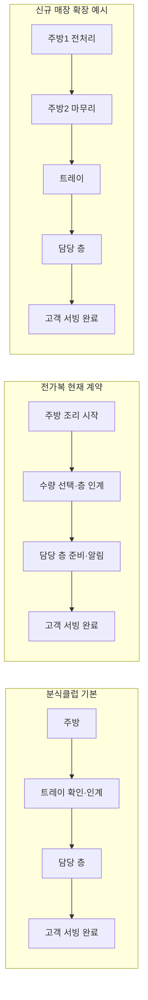

# 신규 매장 개점 구조 진단과 POS 재편 계획

작성일: 2026-10-21 · 대상: 분식클럽, 전가복 및 이후 신규 매장

검토 기준: `e22f9d3e89672e36bbad6c30db303c60bb6a8f26` / `codex/cleanup-existing-workspace-20261021`

상태: **검토 당시의 개선 제안. 이후 사용자 지시에 따라 단계별 구현을 시작했으며, 실제 완료 범위와 회귀검증은 [이행 기록](store_opening_implementation_20261021.md)에 별도로 관리한다. 전체 계획 완료나 운영 배포를 뜻하지 않는다.**

재검증: 같은 기준 커밋에서 주문 접수 이후의 취소·이동·결제·재고, 통신·구형 클라이언트, 설정 활성화 경계를 추가 추적했다. **초안에 불충분했던 필수 계약 10개를 4.1절에 기록하고 설계·구현 순서·통과 기준에 반영했다.** 10.2절은 1차 검토 결과, 10.3절은 이번 재검증 결과다.

## 1. 판단

사용자가 지적한 방향은 코드로 확인된다. 현재 시스템은 개점 설정이 전혀 없는 상태는 아니다. **개점 설정과 최근 추가된 메뉴 선택 기능이 존재하지만, 업무 모델의 변경 가능 범위가 좁고 관련 규칙이 여러 곳에 흩어져 있다.** 그래서 매장별 차이를 추가할 때 화면, SQL 함수, 인계 수량, 계정 배정, 알림, 출력과 주문 채널을 함께 손봐야 한다.

핵심 원인은 다음 세 가지다.

1. 서비스 흐름이 `주방→트레이→층`, `주방→층` 두 종류와 고정된 단계별 수량 컬럼으로 표현된다. 주방을 하나 더 추가하는 것은 설정만으로 해결되지 않는다.
2. 메뉴 선택이 일반적인 선택군 모델 대신 S/L, 면/밥, 기본 맵기와 선택명이라는 개별 필드로 구현되어 있다. M, 여러 맵기 단계, 짜기, 토핑, 필수·복수 선택을 계속 추가하면 영향 범위가 반복해서 넓어진다.
3. 매장 개점 준비 상태가 출력·테이블, 계정, 구매 등으로 나뉘어 있다. 메뉴 선택부터 조리·서빙·결제까지 검증한 **운영 설정 버전과 개점 완료 기준**이 연결되어 있지 않다.

권장 방향은 기존 Flutter·Supabase 안에서 **매장 운영 설정, 메뉴·선택, 주문, 조리·인계, 결제·재고의 계약을 분리**하는 것이다. 이미 존재하는 원자적 결제, 가격 검증, 주문 스냅샷, 부분 인계, 실시간 동기화와 호환 ID를 재사용한다. 전면 재작성이나 마이크로서비스 분리는 이번 문제 해결에 필요하지 않다.

이 보고서의 ‘확인’은 해당 소스 또는 아래의 격리 테스트에 대한 판단이다. 현장 장애 전체의 재현, 운영 DB의 migration 적용 상태, 실제 장치의 동작까지 확인했다는 뜻은 아니다.

## 2. 이미 구현되어 있으며 보존할 부분

| 현재 자산 | 확인 내용 | 재편 시 처리 |
|---|---|---|
| 매장 개점 마법사 | 테이블, 출력 장치, 인력 설정과 출력 테스트가 있다. | 기존 저장·검증 RPC를 새 개점 절차의 구성 요소로 연결한다. |
| 매장별 KDS 흐름 | `kds_workflow`를 출력 모드와 따로 저장한다. 변경은 super admin에 제한하며 진행 주문·인계가 남아 있으면 차단한다. | 같은 권한·대기열 비움 조건을 유지한다. [현재 계약][workflow] |
| 전가복 메뉴 한 번 등록 | 부모 메뉴가 S/L 가격을 소유하고 내부 판매 ID를 유지한다. 면/밥도 내부 조합으로 처리한다. | 고객·관리자 카탈로그에는 한 메뉴를 유지하고 기존 판매 ID를 그대로 연결한다. [현재 선택 구조][meals] |
| 주문 시점 스냅샷 | 선택, 가격, 번역명을 주문에 고정한다. 가격 변경 후 오래된 선택을 거부한다. | 새 선택군에도 동일하게 적용한다. [스냅샷 처리][snapshots] |
| 부분 수량 인계 | 주문 전체가 아니라 선택한 수량을 인계·서빙하는 계약이 있다. | 새 단계 모델의 기본 불변식으로 사용한다. [수량 모델][quantity] |
| 실시간·일괄 처리 | KDS revision/broadcast, 재동기화, outbox와 일괄 RPC가 있다. | 이벤트 전달·재시도 기반을 유지한다. [기존 통신 경로][outbox] |

최근에 해결한 문제를 다시 미구현으로 분류해서는 안 된다. 특히 전가복의 조리 시작과 층 인계 분리는 이미 별도 migration으로 구현되어 있다. 이번 제안은 그 동작을 공통 구조에서도 명확하게 유지하기 위한 것이다. [명시적 인계 구현][handoff]

## 3. 외부 POS에서 차용할 구조

공식 문서와 공개 저장소의 데이터 모델을 확인했다. 아래의 적용 방향은 해당 자료를 바탕으로 한 이 프로젝트에 대한 설계 판단이다.

| 사례와 직접 확인한 내용 | 우리 시스템에 적용할 패턴 |
|---|---|
| **Odoo Preparation Display**: 조리 화면마다 대상 POS·상품 카테고리를 지정하고 진행 단계와 단계별 알림 시간을 설정한다. [공식 문서](https://www.odoo.com/documentation/18.0/applications/sales/point_of_sale/preparation.html), [공식 문서 GitHub 원본](https://github.com/odoo/documentation/blob/18.0/content/applications/sales/point_of_sale/preparation.rst) | 조리 장소, 표시 화면, 업무 단계, 메뉴 라우팅을 각각 설정한다. 이 자료가 임의의 다중 주방 의존 관계까지 지원한다고 해석하지는 않는다. |
| **Odoo POS 주문행 소스**: `product_id`와 `attribute_value_ids`, 사용자 입력 속성, 콤보 부모·자식 관계를 별도 필드로 가진다. [공식 GitHub 소스](https://github.com/odoo/odoo/blob/19.0/addons/point_of_sale/models/pos_order.py#L1609-L1684) | 판매 규격, 주문 시 선택, 세트 구성품을 구분하고 주문행 자체에 선택을 연결한다. |
| **Square Catalog**: 상품 규격과 modifier 목록을 나눈다. 선택군별 최소·최대 선택 수, 기본값, 중복 수량, 추가 가격, 상품별 재정의를 설정한다. [공식 문서](https://developer.squareup.com/docs/catalog-api/enable-modifiers-on-items) | 사이즈는 판매 규격, 맵기·짜기 등은 선택군으로 표현한다. 공통 선택군을 메뉴마다 연결하되 가격·필수 여부는 메뉴별로 지정한다. Square의 modifier 매장 범위 제약까지 그대로 도입할 이유는 없다. |
| **ERPNext POS Profile**: 회사·통화·창고·결제 수단·가격표·세금·사용자·품목군·출력 설정을 하나의 프로필에 연결한다. [공식 GitHub 스키마](https://github.com/frappe/erpnext/blob/version-15/erpnext/accounts/doctype/pos_profile/pos_profile.json) | 매장 개점 시 필요한 설정을 운영 프로필과 검증 결과로 묶는다. 기존 설정 테이블을 모두 하나로 합치는 것은 필요하지 않다. |
| **Floreant POS**: 메뉴와 modifier group을 연결하고 주방 출력 여부를 별도로 설정한다. [공식 메뉴 설정 문서](https://floreant.org/menu-programming-2/), [공식 장치 설정 문서](https://floreant.org/back-office-configuration/) | 고객이 보는 선택과 주방·영수증에 전달할 선택을 구분하고, 업무 경로와 출력 장치 연결을 분리한다. |

외부 제품의 코드를 복사하거나 도입한 것은 없다. 위 자료에서는 구조와 책임 분리 방식을 참고했다.

## 4. 코드에서 확인한 개선 지점

우선순위는 P1=확장 구현 전에 해결할 구조, P2=안정적 확장·유지보수를 위한 후속 작업이다. 아래 항목은 실제 운영 장애로 모두 재현된 결함 목록이 아니라 **확인된 확장 제약과 그로 인한 위험**이다.

| 번호 | 우선순위 | 확인한 구조·근거 | 영향과 필요한 변경 |
|---|---|---|---|
| F1 | P1 | Dart enum과 DB CHECK가 두 KDS 흐름만 허용한다. [Dart][setup-enums], [SQL][workflow] | 주방1→주방2→트레이를 설정으로 표현할 수 없다. 단계·연결·라우팅을 버전 있는 데이터로 표현한다. |
| F2 | P1 | KDS 항목이 `kitchenDoneQuantity`, `trayReceivedQuantity`, `trayDispatchedQuantity`, `floorServedQuantity`와 단계별 switch를 가진다. [모델][quantity] | 새 주방마다 컬럼·조건·이벤트·타이머가 늘어난다. 단계별 진행 레코드를 추가하고 현재 컬럼은 기존 클라이언트의 호환 투영으로 유지한다. 전가복의 트레이 수량을 실제 checker 작업으로 해석하지 않는다. |
| F3 | P1 | `portion_code`는 S/L, `size_prices`는 S/L 두 값만 허용한다. UI와 SQL에 전가복 매장 UUID 제한이 있다. `meal_choices`도 boolean 및 면/밥 두 값이다. [옵션 필드][portion], [가격 검증][sizes], [UI 제한][menu-ui], [면/밥][meals] | M이나 새로운 선택군 추가가 스키마·화면·RPC 변경으로 이어진다. 일반 판매 규격·선택군을 만들고 매장별 활성화 설정으로 연결한다. 기존 매장의 선택을 자동으로 늘리지 않는다. |
| F4 | P1 | 맵기는 `unknown/not_spicy/spicy`라는 메뉴의 기본 속성과 자유 선택명이다. 필수·배타·복수 선택·허용 조합 모델은 해당 등록 계약에 없다. [등록 검증][portion], [편집 UI][options-ui] | ‘매운 메뉴’와 ‘고객이 매운맛을 선택’하는 개념이 섞이기 쉽다. 기본 속성과 주문 선택을 분리하고 선택 수·조합·가격을 서버에서 검증한다. 짜기 등 일반 선택군은 조사한 등록 경로에 없다. |
| F5 | P1 | POS 장바구니 키에는 option key가 들어가지만 QR 키는 판매 ID+포장 여부이고, 직접 주문 초안은 여러 Map으로 분리된다. 서버에도 요청별 판매 ID 중복 제한과 판매 ID 기반 연결이 있다. [POS][cart-model], [QR][qr-cart], [직접 주문][direct-draft], [DB 제한][request-line-unique], [검증 함수][direct-combo-validator] | 현재 S/L·면/밥은 서로 다른 내부 판매 ID로 구별된다. 같은 판매 ID의 ‘덜 짜게’와 ‘짜게’를 지원하려면 카트뿐 아니라 DB 고유 제약·요청→주문 연결·재고/조회 JOIN·세트 구성품 식별까지 바꿔야 한다. R1 참조. 현재 S/L 주문이 합쳐진다는 주장은 아니다. |
| F6 | P1 | 계정 suffix 정규식으로 주방·트레이·층을 배정한다. 최신 전가복 수정도 이 방식에 특별 매핑을 추가한다. [최신 배정 함수][assignments] | `kit2` 같은 계정을 만드는 것만으로 두 번째 주방이 생기지 않는다. 계정·직원·장치와 station ID를 명시적으로 연결한다. 기존 계정명과 권한은 보존한다. |
| F7 | P1 | 기본 개점 틀은 3개 층·4개 물리 프린터 슬롯이다. 인쇄 모드 검증은 주방 destination 한 개를 요구한다. [템플릿][setup-template], [검증][printer-validator] | 새로운 매장 동선을 프린터 틀에 맞추게 된다. 장소·담당 구역·출력 장치를 분리하고 필요한 만큼 연결한다. 현재 고급 출력 설정 자체가 없다는 의미는 아니다. |
| F8 | P1 | 개점 readiness는 테이블·출력 경로·테스트 작업 중심이며 인력/구매 준비는 별도 조회다. [준비 상태][readiness], [조회 서비스][setup-service] | 출력 준비 완료와 매장 운영 준비 완료를 구별해야 한다. 메뉴 옵션·라우팅·장치·결제·재고 준비를 묶은 상위 판정과 모의 주문을 추가한다. 기존 매장의 주문·결제를 새로운 readiness로 갑자기 차단하지 않는다. |
| F9 | P1 | 레시피는 `menu_item_id`로 연결된다. S/L·면/밥 투영 동기화는 기존 판매 ID를 보존하지만 새 선택군별 레시피 연결·차감 규칙을 일반화하지 않는다. 직접 주문 세트에는 별도 차감과 부모 중복 차감 제외가 있다. [레시피 계약][recipe], [투영 동기화][meals], [세트 차감][combo-stock] | 옵션이 재고에 영향을 주면 확장 전 필수 계약이다. 차감 시점·레시피 기준 버전·기조리 취소 소모량·재조리·부모/구성품 중복 방지를 함께 확정한다. L=2배 같은 배율을 추정하거나 기존 레시피를 자동 덮어쓰지 않는다. 현재 차감 오류를 재현한 것은 아니다. |
| F10 | P2 | 최신 KDS migration은 현재 함수 본문을 읽어 문자열 치환한다. 인계 수정에는 선행 본문 일치 검증도 있다. [워크플로 패치][workflow], [인계 패치][handoff] | 선행 함수의 변경에 의존해 최종 동작을 추적하기 어렵다. 신규 핵심 함수는 명시적 정의로 관리하고 migration 전체 재생 후 유효 함수·권한·행동을 확인한다. 과거 migration은 다시 쓰지 않는다. |
| F11 | P2 | 메뉴 조회는 한 번에 비보관 메뉴 전체와 콤보 관계를 읽으며 `*`를 사용한다. [조회][catalog-fetch] | 현재 이것을 N+1이라고 볼 수는 없다. 다만 선택군·규격을 모두 펼쳐 붙이면 응답이 커진다. 카탈로그·선택군을 제한된 일괄 조회로 가져오고 검색·페이지·변경분을 지원한다. |

추가로 시스템 맵은 2026-08-21 기준이며 이후 폐기된 연동과 과거 운영 기준도 포함한다. 실제 코드와 root `CLAUDE.md`의 현재 계약을 우선했다. 구현 단계에서는 기존 시스템 맵의 관련 항목도 갱신해야 한다. 이번 문서는 새 운영 명세가 아닌 진단·제안이다.

### 4.1 재검증에서 보완한 필수 계약

다음은 기존 기능이 없다는 지적이 아니다. **기존 기능과 새 모델을 연결하는 이행 계획이 빠졌거나 충분히 구체적이지 않았던 항목**이다. 모두 해당 확장 기능 활성화 전에 해결한다.

| 번호 | 초안의 누락·불충분한 부분 | 소스 근거와 이번 보완 |
|---|---|---|
| R1 | ‘같은 메뉴·다른 옵션’을 카트 키 문제로만 다룸 | `direct_order_request_items`의 `UNIQUE(request_id, menu_item_id)`와 서버의 동일 판매 ID 중복 거부가 있다. 요청→주문 스냅샷, 재고, 상태 조회도 같은 두 ID로 연결한다. 제약만 풀면 연결 행이 늘거나 스냅샷 대상이 모호해진다. **고유 요청행 ID→주문행 ID 연결 및 구성품 인스턴스 ID**를 전 구간에 도입한다. [제약][request-line-unique], [검증][direct-combo-validator], [연결][request-line-join], [조회][direct-status-join] |
| R2 | 취소·복원·분할·이동을 일반 회귀 항목으로만 기재 | 현행 부분 취소는 청구 수량과 조리 후 취소 소모량을 구분한다. 이동은 단계별 고정 수량, 준비 lot의 FIFO 순서, 층, 금액과 할인까지 함께 옮긴다. 새 진행 원장과 **부분 변경·행 계보·준비 lot·동시 결제 잠금**을 연결하는 어댑터가 필요하다. [취소][partial-cancel], [이동][cashier-move] |
| R3 | 옵션 가격 스냅샷 이후의 금액 배분 규칙 부족 | 현재 세금 프로필, 할인 배분, 서비스 요금, 직접 주문 세트의 반올림 계약이 있다. 유료 옵션의 단위당/행당 금액, 세율별 배분, 분할 잔액과 세금계산서 매핑을 서버 계산 계약에 포함한다. 결제 후 환불은 기존 원장을 덮어쓰지 않는 조정으로 유지한다. [계산기][money-calculator], [세트 반올림][combo-rounding], [환불 원장][payment-adjustments] |
| R4 | 레시피 연결은 있으나 재고 차감 수명주기 미정 | 직접 주문 세트는 승인 트랜잭션에서 구성품을 차감하고 결제의 부모 레시피 차감에서 제외한다. 새 단계마다 재차감하지 않도록 **차감 시점·소모 근거·중복 키·기조리 취소·재조리**를 분리한다. 실제 적용한 레시피 버전/수량을 추적한다. [현행 처리][combo-stock], [취소 소모량][partial-cancel] |
| R5 | station 데이터 변경과 알림·권한·복구의 연결 부족 | 현재 주방 topic은 매장+`kitchen`이며 수신 권한도 station 종류를 검사한다. 주방1/2는 이 구조로 구별되지 않는다. bootstrap 실패 시 legacy snapshot으로 복귀한다. **station ID별 읽기/쓰기·topic·cursor·health·알림 범위**와 동일 업무 의미를 유지하는 복구 경로가 필요하다. [topic][kds-topics], [권한][kds-topic-access], [fallback][kds-fallback] |
| R6 | 업무 설정 버전과 통신/저장 형식 버전 구별 부족 | 기존 queue의 `workflow_version`은 1/2만 허용하는 동작 세대다. 직접 주문 모델은 모르는 필드를 거부하고 오프라인 큐도 형식 버전을 검사한다. 새 설정 버전 ID를 별도 추가하고 **버전별 RPC·응답·초안 변환·기능 협상**을 설계한다. 기존 응답에 필드를 더하는 것만으로 호환된다고 판단하지 않는다. [기존 버전][queue-version], [엄격 파서][direct-parser], [오프라인 형식][offline-version] |
| R7 | ‘진행 주문 비움’ 이후 활성화 경계 부족 | 현행 변경 검사는 열린 주문·미완료 인계·잔여 포장 요청을 본다. 새 계획에서는 아직 주문행이 없는 견적/승인 대기 요청, 구형 오프라인 요청, 활성화와 동시 접수까지 정의해야 한다. **검증한 설정 해시와 예상 활성 버전을 대조하는 원자적 publish**, 접수 경계 공통 잠금, 버전 고정/재확인 정책을 추가한다. [현재 busy 검사][workflow-busy] |
| R8 | 설정 가능한 범위는 있으나 잘못된 설정의 거부 규칙 부족 | 순환·도달 불가 단계, 중복 라우팅, 대상 없음, 합류 수량 불일치, 타 매장 참조, 단계/옵션 보관 이후 진행 주문 처리를 명시하지 않았다. 5.2절의 정적 검증·행 수준 권한·복합 매장 참조 검사와 실제 장치 시험을 활성화 조건으로 추가한다. 이는 신규 설계의 완료 조건이다. |
| R9 | DB 바깥 작업과 출력·가져오기·보고서 계약의 누락 | Auth 계정 생성은 별도 API이며 부분 성공·재시작 경로가 있다. Excel은 구형 파일의 빠진 옵션 열을 보존한다. 프린트에는 재출력 이력이 있다. 이들을 단일 DB 트랜잭션으로 취급하지 않고 **재개 가능한 작업·출력/세금계산서 원본·구형 파일의 비파괴 갱신·보고 집계**를 소비자별 대응표로 관리한다. [계정 worker][account-worker], [Excel][excel-compat], [재출력][print-retry] |
| R10 | 기존 경로 재사용 시 SQL 내부 반복 및 검증 범위 부족 | 현행 테이블 이동에는 주문행→진행행→lot 반복 조회·쓰기가 있고 결제 재고 경로에도 항목/레시피 반복이 남는다. 재사용 대상의 집합 처리 개선을 단계 2~3에 포함한다. 부분 fixture 통과와 전체 migration·운영 유효 함수 검증을 분리하고, 신규 계약별 통과 증거를 붙여야 한다. [반복 이동][cashier-move], [결제 패치 앵커][combo-stock] |

## 5. 권장 구조

### 5.1 매장 운영 프로필과 버전

`매장 → 운영 설정 버전 → 장소/담당 스테이션 + 업무 경로 + 메뉴 게시 버전 + 장치/계정 배정 + 채널 정책`

기존 `restaurants`, `restaurant_settings`, 메뉴, 계정, 장치 테이블은 유지한다. 상위 운영 설정은 각 영역의 확정 버전을 참조한다. 데이터 전체를 자유 형식 JSON 하나에 넣거나 복수의 수정 가능한 원본을 만들지 않는다.

- 상태: 작성 중 → 검증 완료 → 모의 운영 완료 → 활성화. 변경 내역, 실제 설정자, 검증 결과와 버전을 기록한다.
- 브랜드 템플릿은 초기값이다. 템플릿 수정이 운영 중인 매장에 자동 반영되지 않도록 매장별 확정본을 가진다.
- 주문을 접수할 때 적용한 메뉴·가격·업무 경로 버전을 고정한다. 진행 주문을 현재 설정으로 재해석하지 않는다.
- 초기 전환에서는 현행 super admin 권한과 진행 주문·인계 비움 조건을 유지한다. 영업 중 경로 변경은 별도 검증 전까지 허용하지 않는다.
- 메뉴 변경은 관련 메뉴·선택군 단위 revision을 사용해 무관한 메뉴의 장바구니까지 일괄 무효화하지 않는다. 이미 접수한 주문은 불변 스냅샷으로 유지한다.
- `operating_config_version_id`와 `workflow_definition_id`는 새 설정 식별자다. 기존 queue의 `workflow_version`(동작 세대 1/2), 메뉴 revision, API 버전, 오프라인 형식 버전을 각각 구별한다. 하나의 정수나 기존 컬럼에 모두 겸용하지 않는다.
- 게시된 정의는 불변이며 변경은 새 버전을 만든다. 사용 중인 station·옵션·규격은 보관 처리하고 기존 주문/원장 참조를 삭제하지 않는다. 신규 연결은 같은 매장의 객체만 허용하도록 FK/서버 검증과 RLS를 함께 둔다.

### 5.2 장소·스테이션·업무 단계를 분리

‘주방’은 작업 장소, ‘조리 시작/완료’는 작업 상태, ‘주방 태블릿’은 표시 장치다. 서로 같은 ID나 문자열로 취급하지 않는다.

제안하는 최소 데이터는 `stations`, `workflow_versions`, `workflow_steps`, `workflow_edges`, `routing_rules`, `station_assignments`, `fulfillment_step_progress`다. 명칭은 설계 단계에서 확정하며 모두 매장 범위를 가진다. 기존 이벤트 원장·revision·outbox를 확장하고, 전체를 새로운 이벤트 소싱 시스템으로 교체하지 않는다.



사용자 예시의 두 주방은 **같은 요리가 순서대로 이동하는 경우**와 **다른 요리를 각각 만드는 병렬 주방**을 구별해야 한다. 둘을 한 개의 긴 순서로 고정하면 대기 문제가 생긴다.

- 1차 지원: 단일·복수 주방의 순차 이동, 메뉴별 주방 분기, floor-direct 음료, 매장식사·포장·배달 경로 분기.
- 세트의 여러 구성품을 함께 내는 경우: 구성품 수량 비율과 합류 조건을 명시한다. 단순히 각 주방 완료 수량을 더해 서빙 가능 수량으로 계산하지 않는다. 여러 주방의 동일 배치·동일 구성품 연결이 검증된 뒤 확장한다.
- 무한 반복·자유 스크립트형 범용 업무 엔진은 범위에 넣지 않는다. 재조리는 원래 판매를 늘리지 않는 별도 작업 이력으로 표현한다.
- 단계마다 담당자, 시작·완료·인계·되돌리기 권한, 수량, 알림 대상, 타이머 시작점, 다음 단계 조건을 설정한다. 고객 노드는 직원 계정이 아니라 서빙·수령 완료의 기록 대상이다.
- 일대일 수량 경로에서는 다음 단계 인계량이 이전 단계의 가용 완료량을 넘지 못한다. 취소·면제·재조리·세트 소요량은 별도 근거를 기록한다.
- 요청 ID 재전송은 한 번만 반영하고, 후속 단계가 사용한 수량을 임의로 되돌리지 못하게 한다. 진행·감사 이벤트와 화면용 집계를 같은 트랜잭션으로 갱신한다.

활성화 전에는 모든 활성 메뉴/규격·채널·담당 구역 조합에 대해 라우팅을 배치 검증한다. 순환, 시작/종료점 없음, 도달 불가 단계, 동시에 일치하는 규칙의 우선순위 충돌, 경로 없음, 다른 매장 station 참조, 합류 구성품·수량 불일치를 거부한다. 모든 맛 조합을 저장행으로 전개하는 대신 허용 규칙의 교집합과 경계 사례를 검증하고 조합·단계 수 상한을 둔다. 기본 경로도 명시적으로 등록하며 오류를 임의의 주방으로 보내지 않는다.

알림은 station 종류가 아니라 **매장+station ID+업무 정의/배정 revision**으로 범위를 결정한다. snapshot/delta/RPC 쓰기, private topic 권한, cursor·캐시, health, 음성·push 대상까지 같은 매핑을 쓴다. 배정 변경 시 이전 구독·캐시를 폐기하고 다시 인증하며 서버 쓰기도 현재 배정을 검증한다. 신규 경로에서 통신이 실패하면 같은 정의를 이해하는 제한 조회/재동기화 경로를 사용한다. 그런 경로가 없으면 상태와 재시도 방법을 표시하고 변경을 보류한다. 두 주방 주문을 구형 단일 주방으로 조용히 변환하지 않는다. 기존 두 경로의 검증된 fallback은 유지할 수 있다.

### 5.3 메뉴 본체·판매 규격·선택군·주문 선택

| 구분 | 예시 | 설계 원칙 |
|---|---|---|
| 메뉴 본체 | 짬뽕 한 메뉴 | 이름·설명·사진·기본 속성·카테고리. 관리자와 고객 목록에서 한 메뉴다. |
| 판매 규격 | S/M/L, 가격·레시피가 다른 면/밥 규격 | 실제 가격·세금·레시피·재고 계약이 필요한 규격에만 판매 ID를 연결한다. 기존 내부 판매 ID를 유지한다. |
| 선택군 | 맵기, 짜기, 토핑, 면 종류, 소스, 얼음, 당도 | 재사용 가능한 그룹과 허용 값으로 등록한다. 메뉴별 필수 여부·선택 수·가격·허용 조합을 지정한다. |
| 주문 선택 | L + 중간 맵기 + 덜 짜게 | 주문행에 선택 ID, 다국어 표시명, 적용 가격·세금·버전 스냅샷을 고정한다. |

모든 맛 조합을 판매 메뉴 행으로 전개하지 않는다. 예를 들어 사이즈 3 × 맵기 4 × 짜기 3은 36개 고객 메뉴가 아니라 **한 메뉴의 규격과 선택**이다. S/L만 있는 전가복 메뉴에 M이나 새로운 가격을 자동 생성하지 않는다.

선택군에는 최소·최대 선택 수, 단일/복수 선택, 기본값 유무, 동일 옵션 수량 허용 여부, 정렬·번역명, 판매 채널, 메뉴별 사용 여부, 추가 금액, 규격별 허용 값, 일시 품절을 둔다. 실제 필요가 확인된 의존·금지 조합은 명시적 규칙으로 추가한다.

사용자 예시의 맵기 4단계·짜기 3단계는 설정 가능한 모델과 검증 사례로 사용한다. 어떤 실제 메뉴에서 허용하는지, 기본값·추가 가격·레시피 변경이 무엇인지는 확인된 등록 데이터만 사용한다. 기존 `unknown` 맵기는 ‘안 매움’이나 고객 선택값으로 자동 전환하지 않는다.

주문 접수는 POS·QR·직접 주문의 채널별 인증과 승인 절차를 유지하면서 다음 서버 검증을 공유한다.

1. 선택한 규격·값이 같은 매장과 해당 메뉴에 속하는지, 판매 중인지 확인한다.
2. 필수·최대·배타·허용 조합·선택 수량을 전체 주문 배치로 검증한다.
3. 서버가 가격·세금·할인을 계산하고 선택 revision을 검사한다. 오래된 초안은 재선택시킨다.
4. 메뉴 등록·규격 가격·옵션 연결은 하나의 원자적 등록 단위로 저장한다.
5. 초안의 `client_line_id`, 서버 요청행 ID, 주문행 ID와 정규화된 선택 서명을 전 채널에 연결한다. 판매 ID는 메뉴 식별자이며 주문행 식별자를 대신하지 않는다. 같은 메뉴의 다른 짜기·맵기는 다른 행으로 유지한다. 같은 요청 ID에 다른 payload를 재사용하면 거부하고, 같은 payload의 재시도는 기존 결과를 반환한다.
6. 조리·영수증·전자세금계산서·보고서·재고에는 같은 접수 스냅샷에서 필요한 값을 전달한다. 자유 메모는 등록 선택을 대체하지 않는다.

새 구조는 기존 부모 `menu_items`를 메뉴 본체로 재사용하고, 판매 규격 메타데이터와 선택군·연결·선택값 테이블을 추가하는 방향이 적합하다. `menu_items.id`와 판매 규격의 매핑을 유지해 주문·레시피·세금계산서 FK를 끊지 않는다. 기존 옵션 필드의 호환 투영은 새 원본에서만 파생하며 양쪽을 독립 수정하지 않는다.

서버 요청행의 기존 UUID를 재사용하고, 요청행→주문행의 명시 연결을 추가한다. 스냅샷·번역·공개/직원 조회·재고·세금/결제용 임시 스냅샷의 판매 ID 키를 모두 점검한 후 새 버전에서 요청별 판매 ID 중복 제한을 교체한다. 기존 버전 API에는 현재 입력 계약을 유지한다. 세트도 `component_instance_id`로 실제 구성품을 구별한다. 현재 구성품 snapshot의 메뉴 ID 키와 KDS의 `combo:<판매 ID>` line key를 그대로 사용하면 같은 구성품의 다른 옵션을 구별할 수 없다. [세트 식별][combo-line-key]

KDS의 묶음 표시·수량 선택도 별도로 이행한다. 현재 `menuOptionKey` 파서는 `portion_code/spice_level/spice_choice` 세 필드를 취하고 묶음 키는 여기에 이름·메모를 더한다. 신규 짜기/토핑 등을 저장해도 이 키를 유지하면 인계 선택에서 구별하지 못할 수 있다. 업무에 필요한 전체 선택 서명을 사용하고, 실제 allocation은 원래 요청행/구성품/작업 ID로 유지한다. 화면에서 같은 메뉴를 묶더라도 어떤 옵션의 몇 개를 넘겼는지 사라지면 안 된다. [현재 파서][kds-choice-parser], [현재 묶음][kds-choice-group]

### 5.4 주문 접수 이후의 변경 계약

‘주문 수량’ 하나로 청구·준비·전달·소모를 모두 표현하지 않는다. 현행 `billing_cancelled_quantity`, `cancelled_consumed_quantity`와 단계 진행·준비 lot의 의미를 먼저 fixture로 고정하고 새 모델에 대응시킨다.

| 작업 | 새 구조에서도 지킬 규칙 |
|---|---|
| 접수 전 편집 | 옵션/수량 수정·삭제 후 전체 선택과 가격을 재검증한다. 동일 판매 ID라도 다른 선택·메모·포장/수령 조건을 임의 합치지 않는다. |
| 접수 후 옵션/수량 변경 | 원래 선택 스냅샷을 덮어쓰지 않는다. 조리 전/후 허용 범위와 권한을 정하고 기존 행의 변경·취소 이력 및 필요한 새 작업을 명시한다. 이미 승인된 직접 주문의 확정 금액 잠금과 요구사항 재확인 절차를 보존한다. |
| 부분 취소·복원 | 청구 취소와 이미 준비/소모된 수량을 구별한다. 복원 이후 진행이 달라졌으면 오래된 undo를 거부한다. 전체 취소 복원이 앞선 부분 취소까지 되살리지 않는다. |
| 테이블 이동·행 분할 | 원본/분할 행의 계보와 선택 스냅샷, 준비 lot·완료 이력·타이머 시작점을 보존한다. 남은 작업의 대상 층을 갱신하고 음식 재접수·재조리를 만들지 않는다. 이미 완료한 일의 당시 장소/actor는 유지한다. 호환되지 않는 채널/업무 정의 간 이동은 명시적으로 거부한다. |
| 결제와 동시 변경 | 주문·대상 테이블·진행행의 잠금 순서를 공통화한다. 결제 확정 후 수량 변경은 거부하고 조정 원장을 사용한다. 오래된 expected revision/수량의 변경은 충돌로 반환한다. |
| 재조리 | 판매 증가나 자동 환불과 구분한 작업 ID로 사유·승인자·실제 추가 소모를 남긴다. 기존 서빙 완료 사실을 지우지 않는다. |

### 5.5 금액·재고 보존 규칙

유료 옵션은 메뉴 기본 금액과 선택 수량/단위당 추가 금액으로 구성하되, 실제 세율·할인 대상·서비스 요금 기준은 현행 정책을 유지한다. 옵션별 별도 판매행이 필요한지는 세금/재고/계산서 계약으로 결정하고 화면 표시 때문에 중복 청구행을 만들지 않는다. 금액 계산은 서버의 공통 견적/결제 규칙을 사용하고 통화 최소 단위·반올림·잔액 배분을 명시한다.

- 분할 전 금액 = 분할 후 각 행 합계. 공급가·세액·할인·서비스 요금 각각에서 이 관계를 검사한다. 원래 금액에서 분할액을 뺀 잔액을 보존하며 각 조각을 독립 재가격 계산하지 않는다.
- 청구 합계와 결제·환불·선수/추가 입금 원장의 대사가 맞아야 한다. 취소 전/후 매출·메뉴별 분석·마감 보고서는 기존 정책을 유지하고 옵션 JOIN으로 행이나 매출이 배증하지 않아야 한다.
- 실제 등록 actor와 유효기간 기준 계산서 매핑을 유지한다. `effective_to=NULL`은 계속 유효하다. 발행 job의 UUIDv7 `ref_id`와 재시도 식별자를 유지하고, MISA 지연/실패를 결제 실패로 전파하지 않는다. 고객 배달료와 0원 자리표시 행을 생성하지 않는다.
- 채널별 현재 재고 반영 시점을 먼저 확정하고 보존한다. 현행 직접 주문 세트는 승인/결제 트랜잭션의 구성품 차감이다. 주방1·주방2·트레이를 통과할 때마다 차감하지 않는다. 부모/구성품/옵션별 소모의 중복 방지 키와 실제 사용한 레시피·단위·수량을 기록한다.
- 레시피 수정 전 접수한 주문에 어떤 소모 근거를 적용할지 버전 계약으로 확정한다. 기존 주문을 현재 레시피로 일괄 재계산하지 않는다. 필요한 옵션 레시피가 미정이면 추정하지 않고 등록 상태를 명시한다.
- 환불은 돈의 조정이다. 이미 사용한 재료가 자동으로 복구되지 않는다. 조리 후 취소 소모, 폐기, 재조리는 별도 근거로 반영하며 같은 소모 사실의 재처리로 원장을 중복 기록하지 않는다.

### 5.6 검증 결과와 실제 활성화를 연결

1. 검증 대상 설정·메뉴/경로 revision의 해시와 유효기간, 모의 주문 결과, 실제 장치 확인을 기록한다. 관련 설정이 바뀌면 그 범위의 검증을 무효화한다. 경로 검증만으로 프린터 실출력이나 로그인 성공을 대신하지 않는다.
2. 활성화는 예상 기존 버전과 검증한 새 버전을 비교하여 한 DB 트랜잭션에서 수행한다. 주문/직접 요청 접수와 같은 매장 전환 경계를 공유해, 비움 확인 직후 구버전 주문이 끼어들지 않게 한다. 현재 store-opening 잠금과 충돌 없이 공통 잠금 순서를 설계한다.
3. 비움/호환 처리 대상은 열린 주문·미완료 인계·잔여 포장 외에 확정/승인 대기 직접 요청, 예약/지연 이행 요청이 존재하는 채널, 미완료 업무 outbox까지 목록화한다. 처리 중 요청은 정의를 고정해 완료하거나 현행 재확인 절차로 넘긴다. 기존 비움 조건을 유지하고 추가 대상은 새 정의와의 호환성을 판정한다. MISA 같은 비동기 후속 작업은 원본 버전으로 계속 처리하며 서비스 가용성에 활성화를 종속시키지 않는다. 오래된 **미접수 초안**의 재선택과 이미 합의한 주문의 재가격 계산을 혼동하지 않는다.
4. 서버가 보지 못하는 오프라인 큐는 장치별 버전·마지막 동기화·미전송 건수 확인과 재접속 정책을 둔다. 확인할 수 없는 장치는 지원 범위를 명시하고, 미지원 신규 흐름에서는 쓰기를 재개하기 전에 동기화/갱신을 요구한다. 로컬 초안·요청을 삭제하거나 접수 성공으로 위장하지 않는다.
5. Auth 생성·장치 설치·출력·외부 발행은 DB 커밋에 포함되지 않는다. 작업별 상태·재시도 키·부분 성공 대사·재개 위치를 남긴다. 계정 worker의 기존 제한(최대 50개, 동시 2개, 65초)을 보존하고 실패 시 기존 계정을 삭제하거나 비밀번호를 초기화하지 않는다. 필수 준비가 완료되기 전 새 버전 활성화는 막되 기존 매장의 결제는 계속 가능해야 한다.
6. 프린트 job 생성·claim·재시도와 실제 종이 출력은 구별한다. 응답 유실 후 재출력은 감사 이력과 원본 job을 연결하고 화면에 구별한다. 물리 출력에 무조건 ‘정확히 한 번’을 보장한다고 가정하지 않는다. 선택명/다국어/긴 메모의 주방지·영수증·고객 화면 표시도 검증한다.

## 6. 개점 때 추가로 확정할 사항

다음은 기능이 전부 없다는 목록이 아니다. **이미 존재하는 설정까지 한 개점 절차에서 연결·검증해야 하는 항목**이다. 매장에 해당하지 않는 기능은 명시적으로 ‘미사용’ 처리한다.

| 영역 | 개점 시 확정할 기준 | 실제 검증 |
|---|---|---|
| 매장 정체성 | 법인·브랜드·매장, 세금·통화·시간대, 매장 접근 범위 | 다른 매장 데이터 접근 불가, Office 읽기 계약 유지 |
| 공간 | 층/구역의 안정 ID, 저장 코드, 고객 표시명, 테이블·좌석, 담당 범위 | 모든 테이블이 올바른 층으로 연결되고 담당 화면에 표시됨 |
| 업무 동선 | 메뉴별 주방·단계·인계·부분수량·취소·재조리·세트 | 음식·음료·세트별 모의 주문의 도착 대상·완료 순서 확인 |
| 사람과 장치 | 직원/로그인 사용자 구분, station 권한, 태블릿·프린터·고객 화면, 언어 | 실제 장치 로그인과 알림·출력·권한 확인 |
| 판매 채널 | 매장·QR·포장·배달의 사용 여부, 승인·수령 경로, 판매 가능 시간 | 포장·배달이 테이블 층에 잘못 알림을 보내지 않음 |
| 메뉴 | 메뉴 본체·규격·선택군·가격·품절·번역·표시 정책 | 필수 누락 차단, 다른 선택의 행 분리, 가격 수정 후 재선택 |
| 결제·회계 | 결제수단, 세율·가격 포함 기준, 할인·무료서비스 승인, 합산/분할, 환불 | 금액 대사와 결제 중복 방지, MISA 지연 중 결제 완료 |
| 원재료·재고 | 규격/옵션별 레시피 또는 명시적 미연결 상태, 단위, 소요·폐기 규칙 | 주문·취소·재조리·재시도에 재고가 중복 반영되지 않음 |
| 운영 시간 | 영업일, 주문 마감·유예·최종화·현금 일마감 | 날짜 경계의 주문·추가 주문·마감이 각 계약에 맞음 |
| 장애 복구 | 통신 단절, 초안 재전송, 장치 재연결, 인쇄 장애·재출력 | 주문·인계·결제 중복 없음, 놓친 revision 복구 |
| 운영 근거 | 설정 버전·실제 설정자·검증 결과·변경 이력 | 어느 설정으로 어떤 주문을 처리했는지 추적 가능 |

개점 완료는 새 매장/새 운영 버전의 활성화 조건으로 사용한다. 기존 운영 매장의 결제나 주문 처리를 사후에 새 준비 검사항목으로 막지 않는다. 재고 기능을 쓰지 않는 매장의 판매를 레시피 미등록만으로 차단하는 정책도 도입하지 않는다.

## 7. 분식클럽·전가복 보존과 이행

| 계약 | 분식클럽 | 전가복 |
|---|---|---|
| 기본 음식 경로 | 주방→트레이→담당 층→고객 | 주방 조리→명시적 수량 인계→담당 층→고객 |
| 트레이/checker | 기존 역할과 수량·되돌리기 규칙 유지 | 사용하지 않음. `jgbt_tray1` 재생성·재활성화 금지, 감사 이력 보존 |
| 조리 시작 | 현행 매장 동작을 기준으로 고정 | 시작 탭은 조리 시작 수량만 변경. 준비 완료·층 알림은 명시적 인계 때만 발생 |
| 층 | 현재 테이블·담당 층 ID 유지 | 저장 1F/2F/3F 유지. `jgbt_floor_1f`→저장 2F(고객 1F), `jgbt_floor_2f`→저장 3F(고객 2F) 유지 |
| 메뉴 | 현재 메뉴·가격·번역·선택 유지 | 한 메뉴의 S/L 가격·면/밥 선택, 내부 판매 ID 유지 |
| 예외 경로 | 현재 설정된 floor-direct·세트 등 보존 | floor-direct 음료 유지. 포장·배달 준비는 테이블 층에 알림을 보내지 않음 |
| 기존 진행 이력 | 주문·부분 인계·서빙·감사 이력 유지 | 동일. 호환 트레이 수량으로 실제 checker를 만들어내지 않음 |

이행 절차:

1. **실제 데이터 조사와 대응표 작성**: 매장·테이블·계정·메뉴·판매 ID·레시피·세금계산서 매핑·대기열을 매장별 일괄 조회한다. 이름이 같다는 이유로 메뉴를 합치지 않는다. 이미 있는 부모/자식 관계를 우선 사용하고 모호한 관계는 검토 대상으로 남긴다. 실행 전 백업/복원 리허설과 데이터 건수·ID·금액·진행/소모 수량의 대사 기준을 확보한다. 백필 재시작 커서와 미해결 연결을 기록한다.
2. **추가 스키마와 읽기 어댑터 도입**: 기존 테이블·RPC를 유지한 채 새 설정 버전과 연결 테이블을 만든다. 분식클럽·전가복의 현재 동작을 각각 명시적 템플릿으로 옮긴다. 저장 층 코드를 일괄 변경하지 않는다.
3. **기존 데이터의 멱등 백필**: 현재 필드에서 확실히 결정되는 값만 변환한다. 신규 가격·맛 선택·레시피 배율·checker 역할을 추정하지 않는다. 배치 재실행 전후 ID·건수·금액·진행 수량이 같아야 한다.
4. **부작용 없는 비교 실행**: 같은 입력을 기존 경로와 새 판정기로 비교한다. 새 판정기는 알림·출력·재고·결제를 실행하지 않는다. 운영 쓰기 원본은 한 개만 둔다. 실제 쓰기는 선택된 원본과 호환 투영을 한 트랜잭션으로 반영한다.
5. **기존 경로와 같은 템플릿부터 전환**: 먼저 기존 동작의 동등성을 검증한 뒤 두 매장을 매장별로 전환한다. 어느 매장을 먼저 전환할지는 현장 장치·계정 검증 결과로 정한다. 전가복을 자동 시험 매장으로 지정하지 않는다.
6. **확장 기능 활성화**: 순차 주방·새 선택군은 필요한 매장에서만 켠다. 연결된 모든 업무 장치가 새 프로토콜을 지원하고 오래된 오프라인 초안 처리 기준이 마련되어야 한다. 공개 QR/직접 주문의 캐시된 구형 앱은 전수 확인할 수 없으므로 버전별 RPC와 기능 협상으로 지원 범위를 판정하고 필요하면 갱신/재선택을 안내한다. 새 필드를 모르는 응답 파서에 기존 URL/RPC로 새 형식을 보내지 않는다. 이해하지 못하는 클라이언트에 선택·단계를 조용히 생략해서 보여주지 않는다.

`restaurants` 물리 테이블과 `id/name/address/is_active`, `restaurant_id` FK, `stores` 호환 view, `user_accessible_stores`와 접근 RPC를 보존한다. Office 앱은 수정하지 않는다. 등록은 실제 인증된 관리자 actor로 기록하고 결제는 현행 원자적 `process_payment` 계약을 사용한다.

전가복 QR의 미결제 주문은 이미 서빙된 행까지 결제 종료 전 유지하며 10분 표시 초기화로 숨기지 않는다. MISA 발행은 비동기로 유지한다. 고객 배달료, 폐기된 Deliberry 또는 Photo 자동 매출 수집을 새 구조에서 재활성화하지 않는다.

**복귀도 데이터 계약에 따라 설계한다.** 새 구조에서만 표현 가능한 주문이 접수된 뒤 단순 플래그 변경으로 구형 엔진에 넘기면 안 된다. 해당 주문은 새 엔진이 끝까지 처리하고, 진행 주문·인계를 비운 뒤 이후 주문의 경로를 되돌린다. 기존 주문 스냅샷·선택·감사 이력은 삭제하지 않는다. 되돌릴 수 있는 마지막 버전과 장치별 지원 범위를 활성화 전에 기록한다.

추가 migration은 운영 중 쓰기와 함께 적용 가능한 순서로 나눈다. 대량 백필과 제약 검증은 단계화하고 잠금 대기·실행시간 상한을 정한다. 호환 컬럼/RPC를 없애는 단계는 이번 전환과 분리한다. 지원 클라이언트의 전환, 구형 큐 처리, 소비자 대응표의 검증, 복귀 관찰 기간이 모두 끝난 뒤 별도 변경으로 검토한다. 감사·과거 조회에 필요한 데이터는 계속 보존한다.

소비자 대응표에는 담당 코드, 읽는 ID/스냅샷, 지원 API 버전, 검증 fixture, 미완료 여부를 기록한다. 최소 범위는 관리자/Excel, POS/QR/직접 주문, KDS/음성/push/고객 진행 화면, 인쇄 agent/주방지/영수증, 결제/환불/MISA, 재고/레시피/매출·마감 보고, Office의 기존 읽기 계약이다. 구형 Excel에 새 옵션 열이 없는 것은 삭제 요청으로 해석하지 않고, 명시적 비우기와 구분한다. 매출 보고에는 메뉴 본체와 규격·옵션 분석을 구분해 집계 중복을 방지한다. 구매·입고 정책 3 및 과거 정책의 이력도 재고 공통 계층 변경으로 영향받지 않아야 한다.

## 8. 구현 순서와 완료 조건

기간은 운영 데이터 규모·장치 수·미해결 매핑 조사 후 산정한다. 기능이 끊기지 않았다는 판단은 다음 단계별 완료 조건으로 내린다.

| 단계 | 작업·주요 대상 | 완료 조건 |
|---|---|---|
| 0. 현행 계약 고정 | 유효 SQL 함수·trigger·RLS·API 목록, 소비자 대응표, 두 매장 데이터/백업 기준, 취소·이동·세트·금전·재고 fixture | 현재 동작과 운영 데이터/배포 상태를 구별해 기록. 미해결 ID·가격·레시피 연결을 식별하고 영향을 받는 기능의 전환을 보류 |
| 1. 운영 프로필·명시 배정 | 설정/프로토콜 버전 구분, station/층 ID·계정/장치 매핑, 두 workflow 어댑터, 요청행·구성품 ID 계약 | 기존 계정·저장 층·진행 주문 보존. 새 ID의 DB 제약·권한·API/초안 호환 설계 확정 |
| 2. 메뉴 선택·주문행 전체 연결 | 일반 규격·선택군, DB 중복 제약/모든 연결 교체, 메뉴 등록/Excel, 금액·레시피/재고·출력 어댑터 | 같은 판매 ID의 다른 옵션이 접수→결제/재고/조회까지 분리됨. 구형 API/Excel/오프라인 초안 보존. 금액·소모 대사 통과 |
| 3. 단계 진행과 모든 변경 작업 | 단계·라우팅·알림/RLS, 부분 취소/복원·이동/분할·ready lot 어댑터, fallback, 기존 SQL 반복의 집합 처리 | 기존 두 경로 차이 0건. 순차 2주방·세트·floor-direct·포장·배달 및 결제 동시 변경 통과. 올바른 station만 수신/변경 가능 |
| 4. 모의 운영·게시 제어 | 잘못된 설정 차단, 검증 해시·장치 확인, 부분 실패 재개, 동시 접수/오프라인을 포함한 활성화 | 검증 후 수정·동시 접수·장치 미지원·Auth 부분 성공 시 안전하게 보류/재개. 필수 증거가 맞는 버전만 게시 |
| 5. 대사·성능·점진 전환 | 부작용 없는 비교 실행, 전체 migration 및 기존 데이터 업그레이드, 전환/복귀 리허설, CI·현장 검증 | 금액·주문행·재고·완료/대기 수량 차이 0, 시스템 쓰기/알림 중복 0, 재출력 이력 보존, 권한 회귀 0, 성능 기준 충족 |

단계 2와 3의 공통 전제인 주문행·구성품·선택·경로 버전 계약을 단계 1에서 먼저 고정한다. 두 작업을 나눠 구현하더라도 함께 검증하기 전 새 기능을 활성화하지 않는다. 특히 DB 고유 제약부터 단독으로 해제하거나 메뉴 공통화만 끝낸 채 조리·영수증에 선택이 누락되는 중간 버전을 운영에 활성화하지 않는다.

새 핵심 SQL은 현재 함수 정의를 명시적으로 제공한다. 과거 migration의 문자열 치환을 무조건 삭제하거나 기존 함수를 이름만 바꾸어 재사용하지 않는다. 모든 migration을 순서대로 재생한 DB에서 최종 함수와 권한을 검증한다.

배포가 요청되는 구현 단계에서는 `scripts/check_repo.sh`의 관련 검사와 전체 gate를 거친다. 운영 배포는 `scripts/deploy_pos_production.sh` 및 배포 runbook을 사용하고, 정확한 pushed head SHA의 필수 GitHub Actions 성공과 배포 후 확인을 구분해서 기록한다.

## 9. 회귀검증과 성능 기준

### 9.1 기능 회귀표

| 시험 묶음 | 반드시 유지·확인할 결과 |
|---|---|
| 분식클럽 | 주방 완료→트레이 수령/출발→해당 층→고객 서빙, 부분 인계·되돌리기 경계 |
| 전가복 | 시작 탭에는 층 준비/알림 없음. 선택 수량 인계 때 해당 층만 준비·깜박임. checker 계정 생성 없음 |
| 여러 주방 | 주방1→주방2 순서 준수. 메뉴별 다른 주방 분기. 세트 구성품 합류 시 실제 준비량만 서빙 가능 |
| 층·계정 | 고객 표시명과 저장 층 매핑, 프로필 수정 후 동일 배정, 다른 매장·다른 층 권한 차단 |
| 메뉴 선택 | S/L 및 새 모델의 S/M/L, 맵기 4단계·짜기 3단계 fixture, 필수 누락·중복·금지 조합 거부 |
| 카트·초안 | 같은 메뉴의 다른 선택 분리, 수량/선택 편집·삭제, 명시적 checkout, 재연결·가격 수정 후 재선택 |
| 세트·채널 | 구성품·음료 선택, floor-direct, 포장·배달 층 알림 없음, 잔여 음식 포장 이력 유지 |
| 주문 이력 | 미결제 추가 주문·서빙 행 유지, QR 표시 초기화 이후 유지, 과거 가격·번역·옵션 변경 없음 |
| 금전·재고 | 할인·무료서비스·분할/합산·환불의 기존 정책 유지, 전자세금계산서 지연과 결제 분리, 중복 차감·결제 없음 |
| 동시성·장애 | 같은 요청 재전송, 두 장치 동시 인계, 지연/역순/누락 이벤트 복구, 주문 중 설정 변경 거부 |
| 이행·구형 클라이언트 | 백필 재실행 동일 결과, 호환 ID 보존, 구형 화면·초안이 선택을 유실하지 않음, 복귀 후 진행 주문 추적 가능 |

재검증으로 추가한 필수 시험:

| 연결 계약 | 실패를 잡아야 하는 구체적 사례 |
|---|---|
| 요청행·구성품 식별 | 같은 판매 ID+다른 맵기 2행, 같은 구성품+다른 옵션 2개. 서버 접수 거부/스냅샷 덮어쓰기/조회·차감 배증이 없어야 함. KDS 묶음에서 선택한 옵션의 수량만 인계됨 |
| 부분 변경 | 3개 중 1개 준비 후 취소, 반복 부분 취소→전체 취소→복원, 진행 후 오래된 undo, 서로 다른 옵션 행의 부분 분할. 준비·청구·소모·원장 각각 대사 |
| 테이블/층 이동 | 부분 준비된 음식·음료·세트를 다른 층으로 이동. 새 주방 작업 없음, ready lot/FIFO/시각 보존, 이전 층 잔여량·새 층 대상 정확, 결제 동시 실행 충돌 안전 |
| 금액/재고 | 유료 옵션 수량 2, 복수 세율 fixture, 할인/서비스 요금/분할의 반올림 잔액, 접수 후 레시피 변경, 기조리 취소·환불·재조리. 원금/소모가 재시도로 바뀌지 않음 |
| 범위·장애 | 같은 매장의 주방1이 주방2 전용 행을 수신/변경하지 않음. 타 매장 FK/쓰기 차단, 배정 해제 후 접근 차단, bootstrap 실패가 새 경로를 구형 의미로 변경하지 않음 |
| 구형 데이터/프로토콜 | 알려지지 않은 필드에 엄격한 구형 파서, 구형 offline 큐 업그레이드/복귀, 새 열 없는 Excel 재수입. 데이터 보존 또는 명시적 갱신 안내, 조용한 유실 없음 |
| 활성화 | 모의 시험 직후 설정 수정, publish 2회 경합, 전환과 동시에 새 요청 접수, 승인 대기·오프라인 재전송, Auth 응답 유실. 중간 버전 접수/중복 계정/검증 우회 없음 |
| 구성 오류·출력 | 순환/중복/누락 경로, 보관된 옵션 신규 선택 차단과 과거 조회, 한/베/영 선택명 및 긴 메모, 프린터 출력 후 응답 유실 재시도의 명시적 재출력 이력 |

위 시험은 **신규 구현의 통과 기준이며 이번에 통과했다고 주장하는 목록이 아니다.** 기존 검증을 재사용하되 문자열 존재 검사만으로 동작을 입증하지 않는다. 실제 SQL 상태 전이·동시 트랜잭션·파서/큐 변환·화면 표시 시험을 붙인다.

### 9.2 데이터 접근과 부하

아래 숫자는 **제안하는 측정 조건·설계 상한 초안이며 운영 실측 규모가 아니다.** 기존 한도와 실제 매장 데이터를 확인한 뒤 확정한다.

- 측정 규모: 한 매장에 부모 메뉴 500개, 판매 규격 2,000개, 진행 주문행 500개, 장치 20대. 순차 인계와 동시 주문, 연결 복구를 함께 시험한다.
- 카탈로그는 화면에 필요한 메뉴를 최대 100개 단위로 조회하고 규격·선택군은 해당 ID 집합에 대해 소수의 배치로 읽는다. 페이지당 API 호출 목표는 3회 이내이며 메뉴별 추가 요청을 만들지 않는다.
- 업무 진행은 한 요청의 최대 100개 allocation을 한 RPC·집합 기반 SQL로 처리하는 방안을 측정한다. 항목별 SELECT/UPDATE 호출 루프를 새 경로에 만들지 않는다. 잠금 순서를 고정하고 실제 충돌률을 측정한다.
- 재사용하는 `cashier_move_order_items`의 행→진행→lot 반복과 결제의 항목→레시피 반복도 대상이다. 요청 전체의 ID/lot/소모량을 선집계하고 잠금을 안정 순서로 획득한 뒤 집합으로 반영한다. FIFO·잔액·조리 후 취소 소모를 보존하는 시험과 실행 계획을 함께 확인한다. 한 RPC라는 이유로 N+1이 해결됐다고 판정하지 않는다.
- 기존 채널 한도를 유지한다. 직접 주문의 50행/총 100개 한도는 위 KDS 측정 상한과 별개다. 새 옵션 수·선택군 수·경로 단계 수도 상한을 정하고, 규격×옵션×구성품을 무제한 확장하지 않는다. Auth처럼 제공자가 bulk API를 지원하지 않는 외부 쓰기는 제한된 작업·동시성·재시작으로 관리하며 DB N+1과 구별한다.
- 백필은 부모 메뉴 200개 단위, 동시 배치 2개 이하로 시작한다. 전부를 메모리에 펼치지 않고 안정 ID 커서와 재시작 지점을 기록한다.
- KDS 초기 읽기는 허용된 담당 구역·활성 주문만 조회한다. 이후에는 기존 revision/broadcast와 변경 ID 일괄 조회를 사용하며 작은 상태 변경마다 전 매장 snapshot을 다시 받지 않는다.
- 여러 일대다 관계를 한번에 JOIN해 메뉴×규격×옵션×세트 구성품이 곱해지지 않게 한다. 관계별 배치 조회나 선집계를 사용한다.
- 캐시는 매장·권한 범위·언어·채널·관련 revision을 키에 포함하고, 같은 갱신 요청을 합친다. 재시도는 횟수·총시간·동시성을 제한하며 쓰기는 요청 ID로 중복 반영을 막는다.
- `(restaurant_id, workflow_definition_id, station_id, status, id)` 등 후보 인덱스는 실제 필터·정렬과 `EXPLAIN (ANALYZE, BUFFERS)`로 결정한다. 기존 데이터 크기와 쓰기 비용을 확인하지 않은 채 일괄 추가하지 않는다.
- 비교 지표: API/RPC 수, SQL 내부 호출 수, 읽은 행 수, payload bytes, p50/p95 응답시간, DB 잠금 대기, 장치 반영 지연, 클라이언트 메모리. 같은 데이터·장치 수·네트워크 조건에서 전후 비교한다.
- 초기 목표는 동일 부하에서 기존 대비 p95·응답량·메모리 악화 10% 이내, 같은 지역 정상 연결에서 인계 후 화면 반영 p95 1초 이내로 제안한다. 서비스 수준은 현장 기준선을 측정한 뒤 확정하며 현재 달성했다고 주장하지 않는다.
- 전환 후 대사 차이, 권한 오류, 대기열 정체/가장 오래된 작업, 재시도·중복 거부, 알림 대상 불일치를 매장·설정 버전·요청/주문행·작업 ID로 추적한다. 지원하지 않는 흐름, 금액/소모 불일치, 잘못된 대상 전달이 확인되면 신규 버전 접수를 보류하고 이미 접수한 주문은 지원 엔진에서 계속 처리하는 대응 절차를 둔다.

## 10. 이번 검토에서 실행한 검증

### 10.1 읽기·조사 범위

전역 `/Users/andreahn/.claude/CLAUDE.md`, 프로젝트 root `CLAUDE.md`·`AGENTS.md`, 적용 경로의 지시 파일 목록을 확인했다. 필수 지시 파일은 존재하며 하위 경로의 추가 지시 파일은 발견되지 않았다. 시작 시 작업 트리는 깨끗했다. 현재 프로젝트와 지정된 시스템 맵만 확인했고 다른 프로젝트나 과거 worktree 문서는 탐색하지 않았다.

현재 개점·인력 설정, 메뉴 모델/등록/Excel, POS·QR·직접 주문 카트와 스냅샷, KDS 진행·동기화·SQL migration, 레시피 연결, 관련 테스트를 검토했다. SQL 판단은 최신 관련 migration의 재정의·패치를 함께 추적했다. 운영 DB의 실제 유효 정의를 조회한 것은 아니다.

### 10.2 1차 검토 실행 결과

| 실행 | 결과 | 확인 범위 |
|---|---|---|
| 아래 Flutter 기존 테스트 11개 파일 | **61개 통과** | 모델·위젯·오프라인 큐·소스 계약 검사. 실장치/운영 API 시험과 구분한다. |
| `bash scripts/test_menu_meal_choices_cart.sh` | **통과** | S/L·면/밥 4조합, 과거 snapshot 보존, 오래된 가격 키 거부, 선택 비활성/재활성 시 ID 보존, 메뉴 순서 계약 |
| `bash scripts/test_jeongabok_floor_live_sync.sh` | **통과** | 층 실시간 대상·기존 gap 수정·일괄 보강, 전가복 계정의 저장 층 매핑 |
| `bash test/store_opening_printer_modes_sql_test.sh` | **통과** | 출력 모드·원자 저장·권한·테스트 갱신, 매장별 workflow 저장, 진행 주문 변경 차단, 기존 queue snapshot 보존 |

Flutter 실행 명령:

```sh
flutter test --no-pub --reporter expanded \
  test/menu_size_prices_test.dart \
  test/menu_portion_spice_test.dart \
  test/store_onboarding_widget_test.dart \
  test/store_opening_setup_sql_contract_test.dart \
  test/jeongabok_kitchen_floor_test.dart \
  test/kds_start_ready_workflow_test.dart \
  test/kds_tray_floor_customer_delivery_test.dart \
  test/kds_subsecond_set_based_delivery_test.dart \
  test/offline_mutation_queue_service_test.dart \
  test/floor_label_test.dart \
  test/menu_excel_roundtrip_test.dart
```

SQL 검사는 각 스크립트가 만든 격리 Docker PostgreSQL fixture에서 실행했고 종료 시 정리되었다. 운영 데이터에는 접속하지 않았다.

성능 관찰:

- 메뉴 fixture의 부모 500개 일괄 변경에서 projection 동기화 statement trigger 호출은 1회였다. 해당 UPDATE 실행 시간은 약 **257.2ms**였다. 행별 이름/가격 trigger도 존재하므로 이것을 전체 경로에 항목별 작업이 없다는 증거로 확대하지 않는다.
- workflow fixture에서 queue 약 500행의 설정 조회는 **1회**였고, 500개 이벤트 처리도 항목마다 설정을 다시 읽지 않는 assertion을 통과했다. 이는 축약 fixture의 측정이며 실제 전체 운영 함수에 대한 성능 보증이 아니다.
- 네트워크 응답 크기, 실제 장치 메모리, 현장 p95, 운영 동시 사용량은 측정하지 않았다.

검증 한계:

- 전체 `scripts/check_repo.sh`, 전체 migration 재생, 프로덕션 적용 이력, 배포 및 실제 프린터·태블릿·고객 화면은 이번 보고 범위에서 실행하지 않았다.
- 직접 실행한 층 실시간 SQL 스크립트는 `20261021100000`·`20261021120000` 수정을 검사한다. `20261021130000`의 명시적 조리 시작/인계 분리를 전체 선행 migration과 함께 재생한 SQL 통합 시험은 이번에 실행하지 않았다. 별도의 전체 유효 함수 검증이 필요하다.
- 새 구조는 아직 구현되지 않았다. 위 통과 결과는 현재 기능의 일부 기준선이며, 새 구조에서 기능이 유지된다는 검증 결과로 사용할 수 없다.

### 10.3 재검증 실행 결과

같은 커밋에서 본 보고서만 수정했다. 필수 지시 파일을 다시 확인했으며, 시작 시 본 보고서 외의 작업 트리 변경은 없었다. 이번에는 직접 주문행 제약/검증/상태 조회/스냅샷/재고 연결, 부분 취소·복원·이동, 결제·소모·금액 배분, KDS topic 권한/fallback, 구형 파서·오프라인 형식, 개점 publish 경계를 추가 검토했다.

| 추가 실행 | 결과 | 확인 범위 |
|---|---|---|
| `bash test/cashier_item_edit_sql_test.sh` | **통과** | 반복 부분/전체 취소·복원, 준비/서빙 이력·세트 ready lot·기조리 취소 소모 보존, 부분 이동, 권한·오래된 수량 거부, 실제 두 트랜잭션의 결제/이동 경합 |
| `bash test/direct_order_integrated_sql_test.sh` | **통과** | 기존 직접 주문의 금액 대사·환불·세트 snapshot·견적/승인·구성품 차감·승인 재시도, 기존 버전 RPC/로컬 PostgREST, VAT 포함/별도 및 서비스 요금 조합의 반올림 |

두 스크립트는 임시 Docker DB/로컬 서비스를 사용하고 종료 시 정리했다. 직접 주문 fixture의 PostgREST 재시도 측정에서 접수 호출 2회는 요청 1건, 승인 호출 2회는 결제 1건으로 유지되었다. 메뉴 130행의 응답은 1회/44,021 bytes였다. 이 수치는 이번 로컬 fixture 관찰이며 운영 지연·신규 옵션 모델·전체 SQL 경로의 성능 증거가 아니다.

추가 시험도 필요한 선행 스키마/함수를 구성한 fixture다. 특히 직접 주문 통합 스크립트는 세트 migration `20261013030000` 등을 검증하지만 모든 후속 migration을 포함한 전체 재생이 아니다. 따라서 새 선택 모델, 전체 유효 함수, 실제 분식클럽·전가복 데이터/장치, 배포 상태는 아직 검증하지 않았다. 보고서의 로컬 참조·Markdown 구조·공백도 검사했다.

**실행 착수 전 남은 증거**는 운영 데이터 대응표, 실제 적용 migration/유효 함수 목록, 소비자별 버전 현황, 백업/복원 및 전환/복귀 리허설이다. 0단계에서 이를 확보하고 미해결 사항을 기능별 활성화 조건에 연결한다. 이번 재검증으로 모든 잠재 문제가 사라졌다고 단정하지 않는다.

## 11. 실행 제안

첫 구현 범위는 **두 매장의 현재 동작을 검증 가능한 계약으로 고정하고, 개점 운영 프로필·명시적 station/층 배정·버전을 추가하는 단계 0~1**이 적합하다. 이어 메뉴 선택 공통 계약과 단계별 조리 경로를 각각 확장한다.

재검증 후 가장 먼저 확정할 것은 **요청행/주문행/구성품의 식별, 청구·진행·소모 수량의 구별, 설정 버전과 클라이언트 버전의 연결**이다. 이 세 계약 없이 메뉴 화면이나 workflow 테이블부터 확대하면 취소·결제·재고·구형 장치에서 다시 변경이 연쇄된다.

재편 완료의 기준은 새 매장 흐름을 설정할 수 있다는 것에 더해, **분식클럽·전가복의 기존 주문·가격·결제·인계·계정·이력이 새 구조에서도 같은 결과를 내고, 실제 장치까지 확인한 증거가 있는 것**이다.

[workflow]: /Users/andreahn/globos_pos_system/supabase/migrations/20261021150000_store_kds_workflow_settings.sql:6
[setup-enums]: /Users/andreahn/globos_pos_system/lib/features/store_setup/store_setup_models.dart:167
[setup-template]: /Users/andreahn/globos_pos_system/lib/features/store_setup/store_setup_models.dart:333
[setup-service]: /Users/andreahn/globos_pos_system/lib/features/store_setup/store_setup_service.dart:65
[readiness]: /Users/andreahn/globos_pos_system/supabase/migrations/20261019160000_store_opening_printer_modes.sql:492
[printer-validator]: /Users/andreahn/globos_pos_system/supabase/migrations/20261019160000_store_opening_printer_modes.sql:220
[quantity]: /Users/andreahn/globos_pos_system/lib/features/emergency_fulfillment/emergency_fulfillment_provider.dart:192
[outbox]: /Users/andreahn/globos_pos_system/lib/features/emergency_fulfillment/emergency_fulfillment_provider.dart:2941
[handoff]: /Users/andreahn/globos_pos_system/supabase/migrations/20261021130000_jeongabok_explicit_floor_handoff.sql:7
[portion]: /Users/andreahn/globos_pos_system/supabase/migrations/20261020100000_menu_portion_spice.sql:7
[sizes]: /Users/andreahn/globos_pos_system/supabase/migrations/20261020160000_menu_size_prices.sql:12
[meals]: /Users/andreahn/globos_pos_system/supabase/migrations/20261021090000_menu_meal_choices_cart.sql:33
[snapshots]: /Users/andreahn/globos_pos_system/supabase/migrations/20261021090000_menu_meal_choices_cart.sql:156
[menu-ui]: /Users/andreahn/globos_pos_system/lib/features/admin/tabs/menu_tab.dart:1234
[options-ui]: /Users/andreahn/globos_pos_system/lib/core/menu/menu_options.dart:87
[cart-model]: /Users/andreahn/globos_pos_system/lib/features/order/order_model.dart:3
[qr-cart]: /Users/andreahn/globos_pos_system/lib/features/qr_order/qr_order_screen.dart:61
[direct-draft]: /Users/andreahn/globos_pos_system/lib/features/direct_order/direct_order_cart_draft.dart:14
[assignments]: /Users/andreahn/globos_pos_system/supabase/migrations/20261021120000_jeongabok_floor_account_alignment.sql:6
[recipe]: /Users/andreahn/globos_pos_system/supabase/migrations/20260409000002_inventory_recipe_bom_contracts.sql:20
[catalog-fetch]: /Users/andreahn/globos_pos_system/lib/core/services/menu_service.dart:93
[request-line-unique]: /Users/andreahn/globos_pos_system/supabase/migrations/20260821130000_direct_delivery_ordering.sql:148
[direct-combo-validator]: /Users/andreahn/globos_pos_system/supabase/migrations/20261013030000_direct_order_combo_ordering.sql:34
[request-line-join]: /Users/andreahn/globos_pos_system/supabase/migrations/20261021090000_menu_meal_choices_cart.sql:173
[direct-status-join]: /Users/andreahn/globos_pos_system/supabase/migrations/20261013030000_direct_order_combo_ordering.sql:334
[partial-cancel]: /Users/andreahn/globos_pos_system/supabase/migrations/20261009152000_cashier_item_move_and_partial_cancel.sql:162
[cashier-move]: /Users/andreahn/globos_pos_system/supabase/migrations/20261009152000_cashier_item_move_and_partial_cancel.sql:246
[money-calculator]: /Users/andreahn/globos_pos_system/lib/core/payments/payment_total_calculator.dart:66
[combo-rounding]: /Users/andreahn/globos_pos_system/supabase/migrations/20261013030000_direct_order_combo_ordering.sql:247
[payment-adjustments]: /Users/andreahn/globos_pos_system/supabase/migrations/20260604001000_pos_payment_refund_void_adjustments.sql:3
[combo-stock]: /Users/andreahn/globos_pos_system/supabase/migrations/20261013030000_direct_order_combo_ordering.sql:256
[kds-topics]: /Users/andreahn/globos_pos_system/lib/features/emergency_fulfillment/kds_realtime_sync.dart:381
[kds-topic-access]: /Users/andreahn/globos_pos_system/supabase/migrations/20260831010000_kds_realtime_v2.sql:253
[kds-fallback]: /Users/andreahn/globos_pos_system/lib/features/emergency_fulfillment/emergency_fulfillment_provider.dart:1867
[queue-version]: /Users/andreahn/globos_pos_system/supabase/migrations/20260916190000_kds_start_ready_serve_workflow.sql:8
[direct-parser]: /Users/andreahn/globos_pos_system/lib/features/direct_order/direct_order_models.dart:10
[offline-version]: /Users/andreahn/globos_pos_system/lib/core/services/offline_mutation_queue_service.dart:325
[workflow-busy]: /Users/andreahn/globos_pos_system/supabase/migrations/20261021150000_store_kds_workflow_settings.sql:95
[account-worker]: /Users/andreahn/globos_pos_system/supabase/functions/store-account-onboarding/worker.ts:11
[excel-compat]: /Users/andreahn/globos_pos_system/lib/features/admin/menu_import/menu_excel_roundtrip.dart:86
[print-retry]: /Users/andreahn/globos_pos_system/supabase/migrations/20260710002000_receipt_print_queue.sql:459
[combo-line-key]: /Users/andreahn/globos_pos_system/supabase/migrations/20260816190000_kds_combo_component_progress.sql:124
[kds-choice-parser]: /Users/andreahn/globos_pos_system/lib/features/emergency_fulfillment/emergency_fulfillment_provider.dart:458
[kds-choice-group]: /Users/andreahn/globos_pos_system/lib/features/emergency_fulfillment/emergency_fulfillment_provider.dart:1056
